# System Architecture Document (SAD): MVP version

**Product**: Regulatory Intelligence for fund compliance calendars
**Scope**: **MVP only**, cut to fit the operator's five focused days of Build and Deliver (DL-32).
One fictional Luxembourg UCI Part II fund (`FND-DEMO-01`), mock data, mocked roles.
**Status**: **Being rewritten as a lean MVP SAD (`*create-sad --mvp`). Pass 1 of 4 is done:** the
MVP scope, the decisions in force, the evaluation run rules and release rule (DL-34), the five-day
estimate, the known limitations, Future Work and the open questions. **Pass 2 of 4 is done:** Work Ownership
(with the quote-check rule and the run state model), the Delegation Map with its four diagrams,
Pattern Decision, Reference Architecture and §1. **Pass 3 is part done:** Model and Context
Strategy, the Control Register and Production Shape. Still to come in pass 3: §2, §4 and §6. A
heading marked *pending*
has not been rewritten yet. **Nothing is built from a pending heading**; passes 2 to 4 fill them.

> **This document replaces the full design.** The earlier SAD (1,960 lines) described the MVP and
> every deferred feature in one text, so a reader could not tell what to build. That version is kept
> unchanged at git tag `sad-full-design` (commit `9e7da27`). It is a reference for later work, **not
> a build instruction**. Build personas build only what this document describes. Anything listed
> under "Future Work" is not built until the operator moves it into scope.
>
> **IDs are stable.** An ID that stays in the MVP (for example `W-03b`, `CR-009`, `EC-001`,
> `T-RUN-1`) keeps its number and its meaning. A retired ID is listed under "Future Work" and is
> never reused, so references from the PRD, the system description, the stories and the approval
> map still resolve.
>
> **How to read the Trace column.** `SD` = `system-description.md` · `PRD` = `prd.md` · `US` =
> `user-stories/` · `AM` = `approval-map.md` · `DL` = `decision-log.md` · `KEY` =
> `mock-data/expected-obligation-library.md`.

## Input Requirements

**PRD Document**: `project-context/1.define/prd.md`
**MRD**: `project-context/1.define/mrd.md` (evidence note; internal tool, no external market)
**System Description**: `project-context/1.define/system-description.md`
**User Stories**: `project-context/1.define/user-stories/` (US-001 to US-016; US-005, US-014 and
US-016 are not in the MVP)
**Approval map and decision log**: `approval-map.md` (not a requirement in itself; re-checked
against this version in pass 4), `decision-log.md` (DL-01 to DL-35)
**MVP Scope**: the single statement of scope is "MVP scope: the five-day slice" below. No other
section restates it.
**Selected Runtime**: `crewai` (resolved from `AAMAD_TARGET_RUNTIME`; matches `runtime.target` in
`aamad.config.yml`)

## System Architecture Specification

### MVP scope: the five-day slice

**One happy path, start to finish, and nothing else.** If a behaviour is not in this list, it is not
in the MVP.

| # | Step | Owner | IDs |
|---|---|---|---|
| 1 | The specialist starts a run for `FND-DEMO-01`. One run at a time. The demo switch for the planted row is off unless the specialist turns it on for the demo run | Human · backend | W-01, CR-023, CR-029 |
| 2 | The 6 mock source documents are loaded and split into 13 paragraphs with IDs | Code | W-02 |
| 3 | The **extractor** drafts obligation rows: one paragraph ID, a verbatim quote, no dates | CrewAI agent | W-03 |
| 4 | The **quote check** blocks any row whose quote is not word for word in its paragraph | Code | W-04, QN-1, CR-005 |
| 5 | The **verifier** flags internal and cross-source conflicts. It never changes a row | CrewAI agent | W-05, W-06, CR-006 |
| 6 | **G1.** The specialist approves each row and sets its business-day rule (a written reason is required over a flag), or rejects it with a written reason. The **coverage view** lists paragraphs no non-rejected row cites. Each row is decided once | Human · backend | W-07, W-03b, CR-007, CR-027 |
| 7 | The **applicability judge** drafts a verdict per approved row: applies, does not apply or unsure, citing fund fact IDs | CrewAI agent | W-10, W-11 |
| 8 | **G2.** The specialist confirms, overrides with a reason, or decides "unsure" (`OBL-04` as precautionary). Each verdict is decided once | Human · backend | W-12, W-17, CR-007 |
| 9 | Due dates and the calendar are generated by code, all or nothing, with their marks | Code | W-13, CR-008, CR-011 |
| 10 | **G3.** The specialist sees the calendar, the rejected rows and the uncited paragraphs, gives one explicit acknowledgement and publishes; or declines with a written reason | Human · backend | W-15, CR-028 |
| 11 | The **GP view** shows the published calendar and the calendar-level note. Before the first publication it shows the fixed "being prepared" message | Backend (read-only) | W-16, CR-012 |
| 12 | The **audit log** records every agent output, human decision, refusal and gate event | Backend | W-18, CR-013 |
| 13 | **Run states.** A run is `ACTIVE`, `FAILED`, `ABANDONED`, `DECLINED` or `COMPLETED`. A failed step, a time limit or a restart mid-stage ends the run as `FAILED`. The specialist can abandon a run only while it waits at a gate, with a written reason | Backend · human | W-19a, DM-17, DM-18 |
| 14 | The **evaluation report** compares three runs with the answer key and is exported with its trace. It reports; it does not block | Code | W-20, EC-R1, D4 |

**Three CrewAI agents in a gated workflow (DL-17 as reworded, DL-35).** The system stays visibly
multi-agent: the **extractor**, the **verifier** and the **applicability judge** are three separate
CrewAI agents, each defined in the CrewAI configuration files, each with its own model, its own
prompt, no tools and no memory, and each run as a one-agent, one-task crew. What changed is only
what sits around them: **each stage is run by a plain backend function, with no CrewAI Flow
wrapper.** The function calls the agents for its stage, hands their validated outputs to the
backend and ends. **The backend alone owns the gates**: no agent and no stage function can decide,
remember or advance a gate. The pattern is still a workflow (Pattern Decision): the order of the
agents is written in code, and no agent chooses what runs next.

**What a wrong step costs in the MVP.** There is no edit, no reopen and no re-run. A wrong decision
or a failed step is corrected by a **new run**: the specialist abandons the run at a gate (or it has
already failed), starts again and repeats the gate decisions. See "Known limitations".

**Decisions in force.** These shape the build. Each is recorded in `decision-log.md`.

| Decision | What it means for the build |
|---|---|
| DL-14 | The quote check is code and is the authority that blocks G1. The verifier model keeps the conflict checks |
| DL-17 *(reworded 2026-11-12)* | **The backend is the single owner of gate state.** Each stage is run by a plain backend function; the extractor, verifier and applicability judge stay CrewAI agents. Nothing that runs a stage can decide, remember or advance a gate. The CrewAI Flow wrapper around each stage is Future Work (F-11) |
| DL-19, DL-20 | Business-day rules are never guessed by code. An entry whose rule depends on an open question is marked for the specialist (CR-027) |
| DL-21 | CrewAI adapter deviations D1 to D5 and interpretation D6 still apply to the three agents |
| DL-22 | The MVP is one happy path. Edit, reopen, re-run, release, manual rows, duplicate groups and the review notice are Future Work |
| DL-24 to DL-26 | OpenAI API on prepaid credits (US$25 to start, US$50 ceiling until 13 December 2026); one model per role; the verifier's model is settled by the measured bake-off |
| DL-27 | Before the first publication the GP view shows one fixed message and nothing else |
| DL-29 | Abandon only at a gate; a stage time limit; a start-up rule that fails a run interrupted mid-stage |
| DL-30 | Publishing needs one explicit acknowledgement of the rejected rows and uncited paragraphs |
| DL-31 | A demo switch, off by default, adds one planted row that can only be rejected. Evaluation runs refuse to start with it on |
| **DL-32** | **Capacity is five focused days.** Anything beyond that is the operator's buffer, not scope |
| **DL-33** | **Plain server-rendered HTML pages** served by the backend, with one small shared stylesheet (type, spacing, status colours) and **no JavaScript framework**. Page handlers stay thin: they call the same service functions a JSON API would call, so an API can be added later without rework. **Next.js is post-course Future Work** |
| **DL-34** | **Evaluations report; they do not block** (replaces DL-23's gate). Three runs; a pass means 3 of 3; a miss is stated in the report and the demo goes ahead. Tuning is capped at half a day. A run that fails only because of a model-service timeout or outage is voided and re-run once. **The checks that use no model stay blocking** |
| **DL-35** | This MVP rewrite, and three simplifications **accepted by the operator**: (a) a plain stage function in place of a Flow wrapper, on the condition that the three agents stay CrewAI agents; (b) no "out of date" machinery, because each row and verdict is decided once, with the version still recorded on every decision; (c) entry IDs without the quote start position |

### Work Ownership

Each step has one owner. **Model** means a language-model call, made by one of the three CrewAI
agents. **Existing system** means deterministic application code (there is no legacy system; this
is the code the project writes, which owns rules and records). **Human** means the compliance
specialist, acting through the review pages. **Collaborative** means draft-and-decide: a model
drafts, a human decides, and the decision is the record.

**The lens.** Four properties of a language model decide what it may own:

- *Probabilistic output* → a model may draft, never decide or record. Every model output is a
  proposal that code checks and a human decides on. Exact-match targets (SD MP-001 to MP-004) are
  measured, not guaranteed.
- *Knowledge cutoff* → the model is never asked what the law says from memory. It reads the mock
  paragraphs and fund facts it is given, and every claim cites one (SD MN-006, MD-002).
- *Limited working memory* → each model step receives only what that step needs (one document; one
  row and its sources; one row and the fund profile).
- *Steerability* → a model can be talked into a wrong answer by its inputs, so no model output
  changes state. Gates, dates, status and the audit log are code paths with no model in them
  (SD MN-003, MN-005, NFR-003).

Deterministic rules and live records stay with code: due dates, business-day rolls, holiday lists,
stable IDs, gate state, decision versions and the audit log.

| # | Step | Owner | Reversibility | Stakes | Accountable | Rationale and trace |
|---|---|---|---|---|---|---|
| W-01 | Start a run on the mock sources for `FND-DEMO-01` | Human (trigger) · existing system (execution) | High: a run creates drafts only | Low | Specialist | One run at a time (CR-023). Starting a run changes nothing a GP can see. The planted-row switch is off unless the specialist turns it on for this run (see the note below the table). SD FR-001 · US-015 |
| W-02 | Load the 6 mock source documents and split them into 13 paragraphs with stable IDs | Existing system | High | Low | Build crew | Parsing known text. A model here would make the IDs that every later step cites nondeterministic. SD FR-001 · AM A1 |
| W-03 | **Extract** obligation rows: fixed schema, one paragraph ID, a verbatim quote, no dates | **Model** | High before G1: a draft row is approved or rejected, never published as it is | Medium. A wrong row is caught by the checks or at G1. **A missed row is the costlier error** (P-1) and is made visible by W-03b | Specialist (at G1) · Build crew (schema check) | The interpretation work the capstone tests. Code validates the output against the row schema before anyone sees it; invalid output ends the run as `FAILED`. A row's business-day rule defaults to "not confirmed" in code when the model gives none. Any rationale the extractor emits is logged and is not passed to later steps (W-05). SD MD-001, FR-002, MN-005, NFR-004 · US-001 |
| W-03b | **Coverage view**: every loaded paragraph that no non-rejected row cites, shown at G1 and again at G3 | **Existing system** | High: a view only | High: without it a missed row is invisible until the evaluation report | Specialist (reads it) · Build crew | A set difference: loaded paragraph IDs minus the IDs cited by pending or approved rows, with each paragraph's text. The answer key is not used at run time, and the view does not say which uncited paragraphs hold obligations. In the demo set **seven** uncited paragraphs are expected: 13 loaded minus the 6 cited. Three of the seven are the `SRC-PRACT` summaries, which are never a row's source. **A real miss is corrected by a new run.** SD FR-028, AC-029, P-1 · US-001 c4, c8, c10 · DL-10, DL-30 |
| W-04 | **Quote check**: is the quote word for word in the cited paragraph? | **Existing system** (rule QN-1 below) | High | High: a failed check blocks approval with no override (SD MN-006) | Build crew | A string comparison is a fact, not a judgement, so code is the authority (DL-14). The verifier receives the result and cannot overrule it. **A row that fails can only be rejected.** SD FR-003, MN-006, AC-004 · US-002 · AM A4, H3 |
| W-05 | **Internal conflict check**: do the row's fields match what its own quote says? | **Model**, flag only | High: adds a flag, changes no field | Medium: a miss lets a wrong field reach G1 unflagged; the specialist still sees the quote next to the field | Specialist (at G1) | Comparing "+6 months" with "within six months following the end of the financial year" is reading, not string matching. The verifier cannot write row fields (SD MN-004). **Inputs:** the row's fields, its quote, the quote-check result and the cited paragraph. **Not** the extractor's reasoning or prompt: a checker that reads the maker's justification is anchored by it (SD MD-003). SD FR-004, AC-017 · US-003 c5–c6 · AM A5, A6 |
| W-06 | **Cross-source conflict check**: does another source disagree with the row? | **Model**, flag only | High | Medium: false alarms cost trust (PRD AB-3); a miss leaves a disagreement to be found by chance | Specialist (at G1) | As W-05. The verifier receives the row and the full mock source set (6 short documents) and reports flags with both paragraph IDs and both quotes. It never chooses which source is right (SD MN-004). SD FR-004, AC-003 · US-003 · KEY §3 |
| W-07 | **G1 decision** per row: approve and set the business-day rule; approve over a flag with a written reason; or reject with a written reason | **Human** decides · existing system records | **Low inside the run: each row is decided once.** A wrong decision is corrected by abandoning the run (W-19a) and starting a new one. Nothing reaches a GP before G3 | High: this is where a wrong rule enters the library | Specialist | A fixed project gate, not a trust setting (AM §6). Enforced in code: failed quote check → approval refused; remaining flag → reason required; any undecided row → G1 incomplete; a second decision on the same row → refused (CR-009). No bulk or preselected decisions (SD AC-026). SD MD-004, FR-005, AC-006 · US-004 · AM H1, H2, H3, H3a, H4 |
| W-09 | **Gate state and transitions**: G1 complete → applicability may run; G2 complete → the calendar may be generated; G3 → publish | **Existing system** (the backend) | Not applicable (state machine) | Highest: a bypass is the failure the design exists to prevent | Build crew · `@security.eng` verifies | **The backend is the single owner of gate state** (DL-17). A stage function starts only when the backend calls it and ends by returning outputs. No agent and no stage function can decide, remember or advance a gate, and no agent has a tool. Enforced in backend code, never in the page and never in a prompt. Tested without a model (SD NFR-011). SD MN-003, MP-006 · AM A13, A14 · CR-001 |
| W-10 | Load the mock fund profile (fact IDs) and event log | Existing system | High | Low | Build crew | Static mock data, read-only in the MVP (SD §9). SD FR-008 |
| W-11 | **Applicability verdict** per approved row: applies, does not apply or unsure, with reasoning that cites fact IDs | **Model** | High before G2: every verdict is confirmed, overridden or decided by the specialist | High for a wrong "does not apply" (a deadline disappears, the most harmful error, P-1); medium otherwise | Specialist (at G2) | The second interpretation task. The judge is the only source of "unsure" and is told to prefer it to a confident guess when a fact is missing. Code validates the output: one verdict from the allowed set, at least one fact ID that exists, no dates; otherwise the run ends as `FAILED`. SD MD-002, FR-009, AC-007, MN-005 · US-006 · KEY §2 |
| W-12 | **G2 decision** per verdict: confirm, override with a written reason, or decide an "unsure" | **Human** decides · existing system records | **Low inside the run: each verdict is decided once** (as W-07) | High: this decides what is on the calendar | Specialist | G2 cannot complete with any undecided "unsure" (SD AC-008). The **precautionary** label is applied by code from the specialist's decision, never by the model (DL-01): the model's verdict stays "unsure" in the log, and the specialist's "applies (precautionary)" is the record. Cited fund facts are shown read-only. SD MD-004, FR-010, P-1 · US-007 · AM H6, H7, H8, H9 |
| W-13 | **Generate the calendar**: anchors, offsets, conventions `D-1` to `D-7`, business-day rolls against the mock holiday list, event-triggered entries, stable entry IDs | **Existing system** | High: a draft, invisible before G3 | High for correctness (one wrong date breaks trust, PRD AB-5); code ownership removes the probabilistic risk | Build crew · `@qa.eng` (22-entry exact-match test) | No model may compute a date (SD MN-005) and two runs must be identical (SD NFR-001). **Business-day rules are never inferred** (DL-19): a rule is stated in the source or set by the specialist at G1; otherwise it stays "not confirmed" and `D-6` applies (keep the earlier date, mark it). **An entry whose rule depends on an open question is marked, never silently resolved** (DL-20, CR-027); this covers `OBL-02`. Entry ID: `ENT-<fund>-<paragraph_id>-<recipient>-<period>`; if two approved rows give the same ID, generation fails closed and names both rows (DL-35). Runs only after G2 is complete, on approved inputs only. All or nothing (CR-011). SD MD-006, MD-007, FR-011 to FR-013, FR-016 · US-008, US-009 · KEY §4–§5 |
| W-15 | **G3**: publish the whole calendar, or decline with a written reason | **Human** decides · existing system executes atomically | **Low**: there is no unpublish (SD §9). A published calendar is replaced only by a new run and a new publish | **Highest**: the only step that reaches GPs | Specialist | One explicit decision for the whole calendar, never preselected or triggered by a timeout. Code refuses publishing while G1 or G2 is incomplete. **Acknowledgement (DL-30):** the page lists the rows rejected at G1 and the uncited paragraphs (W-03b); the publish request must carry one explicit acknowledgement of those lists, or it is refused (`ACK_REQUIRED`, CR-028). A decline needs a reason, needs no acknowledgement, ends the run as `DECLINED` and cancels nothing. The "date conventions not yet checked" note is shown (DL-12). SD MD-004, FR-014, FR-022, FR-030, MP-006 · US-010 · AM H10, H10a, H11, H11a |
| W-16 | **GP read-only calendar**: what, when, who and why per entry; one calendar-level "not legal advice / conventions not yet checked" note; before the first publication, one fixed "being prepared" message (DL-27) | **Existing system** (renders published data only) | Not applicable (read-only) | High: GPs rely on it | Build crew · `@ux.designer` (wording) | Read-only is enforced on the server, not by hiding buttons. The view reads only the published version; draft, flag and reasoning data are never sent to it (CR-012). SD FR-015, FR-020, MN-007, NFR-010 · US-011 · AM G1r to G3r |
| W-17 | **GP-facing "why" text** per entry: plain-English reason, citation and quote | **Collaborative**: the judge drafts the reasoning (W-11) · the specialist confirms, overrides or decides at G2 · code renders it | Low inside the run (as W-12) | High: a GP reads it as the explanation; it must not imply permission (DL-01) | Specialist (content) · `@ux.designer` (voice, DL-05) | **The GP sees the reasoning of whoever made the final decision.** Confirm → the model's reasoning as confirmed. Override → the specialist's written reason; the model's text stays in the audit log only. Decide "unsure" → the specialist's written reason, plus the code-generated "precautionary" label and note. "Does not apply" → no entry, so no text. **So a G2 reason must be readable by a GP**, and the G2 page says so next to the field (SA-8). G1 reasons are specialist-only. No model runs on the GP path. SD MD-008, NFR-005, P-1 · US-007 c3, c5–c6 · US-011 c2–c5 |
| W-18 | **Audit log**: every agent output, human decision (who, when, what, reason, version decided on), refusal and gate event; update and delete refused | Existing system | Not applicable (append-only by design) | High: the evidence for SD MP-008 and for the review-time measurement (MC-003) | Build crew · `@security.eng` (verifies append-only) | Bookkeeping with no decision in it. Append-only is enforced at the storage boundary (CR-013). SD MD-009, FR-017, NFR-003, AC-016 · US-012 · AM A16, A17 |
| W-19 | **Run status**: the run's state and stage; for a failed run, the step, the unit and the reason in plain words | Existing system | Not applicable (a view) | Medium: the specialist needs it to know that a new run is the next step | Build crew | A view of the run state model below. **There is no re-run**; the status never offers one. SD NFR-004 · US-015 c1–c3, c19 |
| W-19a | **Abandon a run** that is waiting at G1, G2 or G3, with a written reason | **Human** decides · existing system closes the run and refuses further decisions on it | High: nothing is undone or deleted, and a new run can start | Low to medium: abandoning the wrong run wastes review work; no published calendar, decision or audit entry changes | Build crew | **Not a general cancel.** It does not cancel a model call, undo a decision or delete a draft. It is the only way out of a run that waits at a gate and is not wanted, for example after a wrong rejection. Refused without a reason (`REASON_REQUIRED`), on a run that is not active (`RUN_NOT_ACTIVE`), and while a stage is running (`RUN_STAGE_RUNNING`). Audited with who, when, reason and stage. SD MN-003, NFR-004, MD-009, AC-035 · US-015 c20–c21 · DL-29 · AM H13, H13a |
| W-20 | **Evaluation report** against the answer key: rows, flags, verdicts, calendar; run time, model cost, review time from audit timestamps; misses stated, never hidden | Existing system (comparison and report) · reads model outputs as data | High | Medium: the report is the proof (PRD §7); a hidden miss would be the harm | `@qa.eng` | Scoring is a deterministic comparison with KEY §1–§4. Three runs; **the report states the result and does not block** (DL-34, EC-R1). The altered-quote and `I-1` cases run on copies of rows, not on the mock sources. An evaluation run refuses to start with the planted-row switch on (EC-R7). SD FR-018, MP-001 to MP-004 · US-013 · DL-10, DL-11 |
| W-21 | **Mocked identity** (specialist or GP), attached to every decision and checked on every write | Existing system | Not applicable | Medium for the demo; **not an access-control claim** (AM §3) | Build crew | Enforced on the server: identity lives in code, not in a prompt (CR-004). Real authentication is out of scope (SD A-5). SD NFR-010 |

*Not in this table:* `W-03a`, `W-07a`, `W-08`, `W-14`, `W-22` and the re-run part of `W-19` are
retired from the MVP (Future Work F-01, F-05, F-06, F-07, F-09).

**The planted demo row (DL-31, CR-029).** When the specialist starts a run with the switch on,
**code** adds one row from a fixed fixture; the extractor never does. The row carries a real quote
that is word for word in its paragraph but does not support the row's rule, so the quote check
passes and the judgement is left to the specialist. **The verifier runs on it like on every other
row** (operator decision, SOQ-22), so the planted row follows the same path as the rest and nothing
is special-cased; a flag, if the verifier raises one, is shown at G1 as usual. **The demo does not
depend on whether the verifier flags it:** the specialist rejects the row at G1 either way, and
approving it is refused either way. The row is marked `origin: demo` and labelled
"demo" everywhere it appears. The backend refuses to approve it (`DEMO_ROW_NOT_APPROVABLE`), so its
only decision is reject with a reason, and it can never reach a calendar. SD FR-031 · AM A26, H3a.

**Quote-check rule (QN-1), for W-04.** The row's quote and the cited paragraph are normalised the
same way; the quote must then occur as one unbroken piece of the paragraph.

1. Trim whitespace at the start and end.
2. Replace every run of whitespace (spaces, tabs, line breaks) with one space. *Reason:* the mock
   paragraphs wrap mid-sentence, while a quote is written on one line.
3. Nothing else. Comparison is case-sensitive. Punctuation, typographic quotes and apostrophes,
   dashes and Unicode forms are **not** normalised; a difference in any of them fails the check.
4. A row with no paragraph ID, or an ID that matches no loaded paragraph, fails.

A failed check blocks approval of that row. No reason unlocks it (AM H3).

**Tests for W-04** (run without a model, SD NFR-011; `@qa.eng` implements):

| ID | Setup | Expected | Trace |
|---|---|---|---|
| T-W04-1 | The 6 answer-key quotes against their paragraphs | All pass | US-002 c1 · KEY §1 |
| T-W04-2 | The `OBL-01` quote with "calendar" changed to "business" | Fails; approval refused, with or without a reason | SD AC-004 · US-002 c2 |
| T-W04-3 | A correct quote with its line break replaced by two spaces and a trailing space added | Passes (rule steps 1–2) | US-002 c8 |
| T-W04-4 | A correct quote with one straight quote mark made typographic, or one letter's case changed | Fails (rule step 3) | US-002 c8 |
| T-W04-5 | A row with no paragraph ID; a row citing an unknown ID | Both fail | US-002 c3 |
| T-W04-6 | The verifier's output claims "quote ok" for a row the code failed | The code result stands; the row stays blocked; the disagreement is logged | SD MN-006 |

**Failure inside a stage.** Stages A and B are made of one model call per unit: one per source
document for extraction, one per row for the verifier and for the judge. A call that fails on a
transport or provider error gets **one** automatic retry (D1). If a unit still fails, or its output
fails schema validation, the stage ends and the run becomes `FAILED`. Valid outputs from the other
units stay in the trace as a record. **No gate opens on a failed stage**, and nothing is re-run: a
new run follows. Every call, including the retry, counts towards the run's cost and time (SD
MC-001, MC-002).

**Run state model (DL-22, DL-29).** A run is in exactly one state. Only `ACTIVE` blocks a new run.
A **terminal** state is an end state: the run is over and its state never changes again.

| State | Meaning | Ends when |
|---|---|---|
| `ACTIVE` | A stage is running, or a gate is waiting for the specialist | A stage fails (`FAILED`), the specialist abandons it while it waits at a gate (`ABANDONED`), or G3 is decided (`COMPLETED` if published, `DECLINED` if declined) |
| `FAILED` (terminal) | A unit returned invalid output, a call failed after its one retry, a task or the whole stage passed its time limit, the cost cap stopped the run (CR-017), or the backend restarted while a stage was running. Run status names the step, the unit and the reason | Never; a new run follows |
| `ABANDONED` (terminal) | The specialist closed a run waiting at G1, G2 or G3, with a written reason (W-19a) | Never; a new run follows |
| `COMPLETED` (terminal) | G3 was decided by publishing the calendar | Never |
| `DECLINED` (terminal) | The specialist declined G3 with a written reason. Nothing new was published; GPs keep any earlier published version | Never; a new run follows |

Rules:

1. **No gate opens on a failed stage.**
2. **A run in a terminal state is never resumed and never re-run.**
3. **Ending a run undoes nothing.** Recorded decisions, drafts, the audit log, the traces and any
   published calendar stay as they were, and GPs keep seeing the last published version.
4. A decision on a run that is not `ACTIVE` is refused (`RUN_NOT_ACTIVE`), and no model call is
   started for it.
5. A new run is refused only while a run is `ACTIVE` (CR-023).
6. **Every running stage ends by itself.** Each model task has a time limit, and the backend also
   enforces a time limit per stage (`STAGE_TIME_LIMIT_A`, `_B`, `_C`). The starting values are set
   in §2 and confirmed by the measurement spike in estimate block B3.
7. **Start-up rule.** When the backend starts, an `ACTIVE` run whose stage was running becomes
   `FAILED` with the reason "service restarted", logged as a system event. A run waiting at a gate
   is unaffected.
8. **Abandon only at a gate.** Abandon is refused while a stage is running (`RUN_STAGE_RUNNING`);
   the stage ends by itself under rule 6, so no model call is left running for output nobody uses.

**Steps with no model, by requirement:** W-02, W-03b, W-04, W-09, W-10, W-13, W-16, W-18, W-19,
W-19a, W-21. The tests for W-09, W-13 and W-18 run without a model (SD NFR-011).

**Model steps:** W-03 (extractor), W-05 and W-06 (verifier), W-11 (judge). Each produces a draft
that code validates against a schema and a human decides on at a gate. None can write to the
library, the calendar, the gate state or the audit log, except that its own output is logged as a
proposal.

**Feasibility verdict**: `feasible with constraints`

**Load-bearing constraint: five focused days, with no slack inside the estimate** (DL-32). The
ownership split is feasible as designed: the model steps are small, bounded and reviewable, and
everything consequential is code. What decides the outcome is time. The estimate is about 5.5 days
against a capacity of 5, and the operator's buffer is the only margin (see "Estimate").

Two further constraints, named so they are not mistaken for guarantees:

- **Exact-match model targets are measured, not guaranteed.** SD MP-001 to MP-003 ask for 6 of 6
  rows, 6 of 6 verdicts and exactly the planted flags from probabilistic steps. The design makes a
  miss visible (W-20) and harmless to GPs (W-09, W-15). It cannot make a miss impossible, which is
  why the evaluation reports and does not block (DL-34).
- **Cost and time budgets bound the pattern.** Under US$2 and under 5 minutes per run (SD MC-001,
  MC-002) on 6 documents and 6 rows is comfortable for a fixed sequence of small calls. It would
  not be for an open-ended agent loop (see Pattern Decision).

### Delegation Map

A one-page summary of who does each step, read against the approval map. Work Ownership above
holds the detail and is the authority; this table adds the approval-map rule. **Agent** = one of
the three CrewAI agents. **Code** = a deterministic step. **Human** = the specialist (mocked
role). **Backend** = the gate service, the records and the run state. Approval-map rules are
**Alone**, **Ask** and **Never** (`approval-map.md` §4).

| # | Step | Owner | Why this owner | Why not the alternatives | Approval-map rule | Trace |
|---|---|---|---|---|---|---|
| DM-01 | Start a run | **Human** triggers · **backend** executes | Only the specialist decides when work starts; the backend checks that no run is `ACTIVE` | Not an agent: starting work is not a judgement. Not automatic: the MVP has no schedule | H0 **Ask** · A24 **Never** (start while a run is active) · A26 **Alone** (code adds the planted row, only with the switch on) | SD FR-001, FR-031, AC-036 · US-015 · W-01 · CR-023, CR-029 |
| DM-02 | Load the mock sources and split them into paragraphs with IDs | **Code** | Parsing known text; every later step cites these IDs | Not an agent: it would make the IDs nondeterministic | A1 **Alone** | SD FR-001 · US-001 c1 · W-02 |
| DM-03 | Extraction: draft obligation rows with one paragraph ID and a verbatim quote, no dates | **Agent** (extractor; the cheaper model) | Reading regulatory text into a schema is the interpretation the capstone tests | Not code: the wording varies too much for rules. Not human: the aim is to move the specialist from writing to checking | A2, A3 **Alone** (a draft) · A10 **Never** (no model dates) | SD FR-002, MN-005, AC-001, AC-002 · US-001 · W-03 · DL-25 |
| DM-04 | Quote check: is the quote word for word in the cited paragraph? **Blocks approval on failure** | **Code** (QN-1) | A string comparison is a fact, not an opinion, so it must be the authority | Not an agent: a model "pass" is a guess about something code can know. No override: no reason unlocks a failed check | A4 **Alone** · H3 **Never** (approve with a failed check) | SD FR-003, MN-006, AC-004 · US-002 · W-04 · DL-14 |
| DM-05 | Verifier: internal and cross-source conflict checks; flags only | **Agent** (verifier; a mid-tier model, different from the other two) | Seeing that "+6 months" disagrees with a quote or with another source is reading, not matching | Not the extractor: the checker must be separate (SD MD-003). Not code: disagreement is a matter of meaning. It never edits a row or chooses a source | A5 **Alone** · A6 **Never** (change a row) | SD FR-004, MD-003, MN-004, AC-003, AC-017 · US-003 · W-05, W-06 · DL-26 |
| DM-06 | Coverage view: paragraphs no non-rejected row cites, at G1 and G3 | **Code** | A set difference; it makes a missed row (the costliest error, P-1) visible | Not an agent: nothing may judge which paragraphs hold obligations. No answer key at run time | A23 **Alone** | SD FR-028, AC-029 · US-001 c8, c10 · W-03b |
| DM-07 | **G1**: approve each row (with a reason over a flag) or reject it with a reason. Each row is decided once | **Human** decides · **backend** records and enforces | Only a person may let a rule into the library | Not an agent: agents have no approve tool. Not code: approval is a judgement. No bulk or preselected decisions | H1 **Ask** · H2 **Ask**, reason · H4 **Ask**, reason · H3, H3a **Never** · A13 **Never** | SD FR-005, MD-004, AC-006, AC-026 · US-004 · W-07 |
| DM-08 | Applicability: applies, does not apply or unsure, citing fact IDs | **Agent** (judge; the reasoning model) | Judging a rule against fund facts is the second interpretation task; the judge is the only source of "unsure" | Not code: applicability conditions are prose. Not human first: the specialist decides at G2 instead of starting from nothing | A8 **Alone** · A14 **Never** (confirm its own verdict) | SD FR-009, MD-002, AC-007 · US-006 · W-11 · DL-25 |
| DM-09 | **G2**: confirm, override with a reason, or decide "unsure" (`OBL-04` as precautionary). Each verdict is decided once | **Human** decides · **backend** records and enforces | A verdict decides what is on the calendar; "unsure" needs a person | Not an agent: it cannot decide its own "unsure". Not code: code applies the precautionary label only from the human decision | H6 **Ask** · H7 **Ask**, reason · H8 **Ask**, blocking · H9 **Never** | SD FR-010, P-1, AC-008 · US-007 · W-12 · DL-01 |
| DM-10 | Due dates: anchor and offset, conventions `D-1` to `D-7`, business-day rolls, events, marks | **Code** | Dates must be identical every time and testable without a model | Not an agent: a model may never compute a date (SD MN-005). No guessed roll rules (DL-19); open conventions are marked (DL-20) | A11 **Alone** (after G2 only) · A10 **Never** | SD FR-011 to FR-013, NFR-001, AC-009 to AC-012, AC-032 · US-008, US-009 · W-13 |
| DM-11 | Calendar generation: one complete version with stable entry IDs, or nothing | **Code** | All-or-nothing generation prevents a partial calendar | Not an agent: no model step. Not human: the specialist reviews the result at G3 | A11 **Alone** · A22 **Never** (partial calendar) | SD FR-016, NFR-004, AC-015 · W-13 · CR-011 |
| DM-12 | **G3**: publish the whole calendar after one explicit acknowledgement of the rejected rows and uncited paragraphs, or decline with a reason (the run ends `DECLINED`) | **Human** decides · **backend** records and enforces | Publishing reaches GPs and cannot be withdrawn in the MVP | Not an agent: agents have no publish tool. Never preselected or triggered by a timeout | H10 **Ask** · H10a **Ask**, reason · H11, H11a **Never** | SD FR-014, FR-022, FR-030, AC-021, AC-026, AC-037 · US-010 · W-15 · DL-30 · CR-028 |
| DM-13 | Publishing: switch the fund's published version in one indivisible step | **Backend** | It carries out the G3 decision as one change | Not a stage function and not an agent: neither holds or changes gate or publication state (DL-17) | Carries out H10 · A21 **Never** (working content to GPs) · A22 **Never** | SD FR-014, FR-015, AC-013 · CR-011, CR-012 |
| DM-14 | GP view: the published calendar and the calendar-level note; before the first publication, the fixed "being prepared" message | **Backend** (read-only) | GPs must see only what the specialist published | Not an agent: no model on the GP path (W-17). Read-only is enforced on the server | G1r **Alone** · G2r **Never** (a GP changes anything) · G3r **Alone** | SD FR-015, FR-020, MN-007, NFR-010, AC-013, AC-014 · US-011 · W-16 · DL-27 |
| DM-15 | Audit log: every agent output, human decision, refusal and gate event, with versions | **Backend** | Append-only bookkeeping that proves who decided what | Not an agent and not a stage function: records must outlive both and refuse edits at the storage boundary | A16 **Alone** · A17 **Never** (edit or delete) | SD FR-017, MD-009, NFR-003, AC-016 · US-012 · W-18 · CR-013 |
| DM-16 | Gate state, decisions and versions | **Backend** | One owner of where the run is; it refuses any advance without the matching decision | Not a stage function and not an agent: with two owners, two records of the gate would have to agree (DL-17). Not the page: hiding a button is not enforcement | A13 **Never** · A14 **Never** | SD MN-003, MP-006, MD-009 · W-09 · CR-001, CR-009 · DL-17 |
| DM-17 | **Failed run**: invalid output, a failed call, a time limit, the cost cap or a restart mid-stage → `FAILED` (terminal) | **Backend** (automatic) | Fail closed: nothing moves forward on bad output, and a new run is then allowed | Not human: a failure must not wait for someone to notice. No re-run in the MVP | A15 **Alone** (stop and log) · A25 **Alone** (start-up rule) | SD NFR-004, AC-033, AC-034, AC-036 · US-015 · Run state model · DL-29 |
| DM-18 | **Abandoned run**: the specialist closes an `ACTIVE` run waiting at a gate, with a written reason → `ABANDONED` (terminal) | **Human** decides · **backend** records | The only way to end a run waiting at a gate (for example after a wrong rejection) without undoing anything | Not automatic: a gate wait never times out (SD AC-026). Not mid-stage: a running stage ends by itself (DL-29) | H13 **Ask**, reason · H13a **Never** (abandon mid-stage) | SD AC-035, AC-036 · US-015 · W-19a · Run state model · DL-29 |

Steps that are Future Work have no row here; they are listed once, under "Future Work".

**Diagrams.** The four structural views the architect owns are drawn with `draw-diagram` under
`project-context/diagrams/system-arch/`. All four were updated for DL-33 and DL-35 by changing
labels only; no box or arrow was added or removed.

*View 1: system context.* Who and what the running system touches. The specialist runs it and
decides at G1 to G3. The GP only reads what is published. The system reads the mock data and
configuration files, and the OpenAI API is its only live external service (SD MN-002, DL-25).
Filing parties (no role in the MVP), Claude Code (the build tool, not part of the running system)
and the answer key (evaluation only) are left out.

The editable source is `project-context/diagrams/system-arch/context.html`.

*View 2: containers.* Inside the system. The browser requests plain HTML pages from the backend
(DL-33); it runs no application code of its own. The backend owns gate state, decisions and
versions, and runs one plain stage function per stage. Each stage function calls the three CrewAI
agents (the only parts that call the OpenAI API) and the code steps, ends at its gate and returns
its outputs to the backend. **Only the backend decides or remembers gate status** (DL-17). Both
stores sit in one SQLite file. They are drawn as two boxes because they follow different rules:
business data is ordinary records, while the audit log and trace are append-only, enforced by
triggers (CR-013). The people (view 1), the evaluation runner and answer key, and the inside of
each agent (view 3) are left out.

The editable source is `project-context/diagrams/system-arch/containers.html`.

*View 3: the agent pipeline.* The MVP's steps in their three stages, with the specialist's gates
drawn as boxes between them, so the picture cannot be read as an automatic pipeline: agents only
draft, and nothing moves on until a person decides (SD MN-003). Stage A: the extractor drafts
rows; the code quote check (the authority that blocks G1, W-04) and the verifier check them; the
code coverage view lists uncited paragraphs. Stage B: the judge drafts verdicts for the approved
rows, then G2. Stage C: the code date engine, then G3. Agents and code steps have different box
styles, and each agent's label names its model tier and what it receives (DL-25, DL-26). Two
callouts: the verifier never sees the extractor's reasoning (W-05), and no agent has a tool, so
code builds every input from stored data (CR-002). The planted demo row, the backend, the stores
and the audit log (views 2 and 4) and the evaluation runner are left out.

The editable source is `project-context/diagrams/system-arch/pipeline.html`.

*View 4: gates and approvals.* Who may change state, and where that is enforced: one permitted
route into a protected zone, and two blocked routes that stop at its edge. The specialist's
decisions pass the server's role and version checks (CR-004, CR-009) into the gate service, which
alone changes gate state, decisions and versions, refuses what the rules forbid, and appends every
decision and every refusal to the audit log (CR-001, CR-013). Refusals at the role check and the
version check are written through the same append path, so every refused request is recorded
with who, when, what was asked and why it was refused (SD MD-009). The stage functions and agents
may only return drafts; writing state is blocked (AM A13, A14: **Never**). The GP reads only the
published calendar (CR-012); any GP write is blocked (AM G2r: **Never**). The three gates share
one enforcement route, so they are drawn as one gate service; their separate rules are in the
table above. The OpenAI API, the code steps, the pages and configuration are left out.

The editable source is `project-context/diagrams/system-arch/gates.html`.

Behaviour views (a run flowchart, a sequence of one stage, a run state diagram) belong to other
personas under `.cursor/skills/draw-diagram/reference.md`. This document holds their content as
text: the run state model in Work Ownership, and the data flow in §6.

### Pattern Decision

- **Primary shape**: `workflow`
- **How to describe the system**: **three CrewAI agents in a gated workflow.** "Multi-agent" here
  means three agents with separate roles, models and prompts. It does not mean an agent that plans
  its own steps: the order of work is written in code.
- **Workflow sub-shape**: **chaining** between stages, with **parallelization** of the per-unit
  model calls inside a stage. Human gates break the chain, so the product is three short workflows
  run one after another, not one long-running process:

  | Stage | Steps (Work Ownership IDs) | Model calls | Ends at |
  |---|---|---|---|
  | A. Extract and verify | W-02 → W-03 → W-04 → W-05 + W-06 (per row, in parallel) → W-03b | 1 extractor call per source document (6), then 1 verifier call per row (6, or 7 with the planted demo row) | **G1** (W-07), human |
  | B. Judge applicability | W-10 → W-11 (per approved row, in parallel) | 1 judge call per approved row (up to 6) | **G2** (W-12), human |
  | C. Generate and publish | W-13 | **None** | **G3** (W-15), human; then W-16 |

  A stage is complete only when every unit has a valid output, and only then does its gate open. A
  failed unit ends the run (Work Ownership, "Failure inside a stage").

- **Deciding factor**: **predictability.** The requirements write the path in full: extract →
  verify → G1 → judge → G2 → dates → G3 (SD FR-001 to FR-014). No step needs a model to decide
  what happens next, and the three gates must happen at fixed points (SD MN-003). An agent that
  plans its own steps is justified only when the path cannot be written in advance. Here it can,
  so the first factor decides and the other four confirm it:

  | Factor | Workflow | Why it also rules out the alternatives |
  |---|---|---|
  | Predictability | Fixed order, fixed gates, fixed outputs per step | A planning agent could reorder, repeat or skip work around a gate |
  | Error cost | Each model output is a schema-checked draft that stops at a gate; a wrong draft costs review time, never a wrong calendar | One call that extracts and checks itself has no separate verifier (SD MD-003) and no G1 between extraction and judgement |
  | Observability | Every step's output is a logged record with a step name and run ID (US-012 c1); run status names the step (US-015 c1) | "What should I do next" reasoning is harder to show a specialist than "step 3 of 4 finished" |
  | Latency | About 18 small calls per run (19 with the planted demo row), per-unit calls in parallel; expected under 5 minutes (SD MC-001). *An estimate, measured by the spike in block B3 and by US-013* | An open-ended loop has no fixed upper bound |
  | Cost | Six short documents and one fund profile; a few thousand tokens per call; expected under US$2 (SD MC-002). *An estimate, measured the same way* | Turn count, not input size, drives an agent's cost |

- **Rejected alternatives and reversal cost**:

  | Alternative | Why rejected | Cost to reverse later |
  |---|---|---|
  | **Planning agent** (a model orchestrates extraction, verification and judgement as tools) | The path can be written in advance, the gates are fixed, and no MVP requirement needs run-time planning | **Low to medium.** Each model step is a bounded, schema-validated function with no tools, so an orchestrator could call them unchanged. A tool allowlist, a turn budget, stop conditions and a human gate before any irreversible call would have to be added. The gate and date code would not change |
  | **One augmented call** (one model call producing rows, flags and verdicts together) | Breaks SD MD-003 (the verifier is separate from the extractor) and puts G1 inside a single call. It also ties extraction errors to applicability errors | **High.** The gates and the separate verifier would have to be put back; the row schema and the audit detail would change |
  | **Evaluator-optimizer** (the verifier's flags go back to the extractor, which revises until the verifier passes) | A model would change a row in response to a flag. SD MN-004 says the verifier never changes a row, and SD MD-004 says the specialist resolves a flag with a reason. **The human closes this loop, by design** | Not applicable: this is a requirement, not a reversible design choice |
  | **Routing** as the primary shape | The inputs do not vary in kind: every run takes the same six documents through the same steps | Not applicable |

- **Progression used**: prompt → **structured output** (every model step returns a fixed schema
  that code validates; invalid output ends the run, SD NFR-004) → **inputs placed in the prompt by
  code, not retrieved** (the mock corpus is small, so each call receives the documents it needs; no
  vector search, no tools) → evaluator-optimizer **not used** (see above) → fine-tuning **not
  used** (not needed for six documents).

**Agent-only fields** (recorded for completeness; the shape is a workflow, so none applies as an
agent control):

- **Tool allowlist**: **empty.** No agent has a tool. Code reads the mock sources and the fund
  profile and places them in the prompt. This is stronger than an allowlist. Code, never a model,
  reads live state (gate status, versions, decisions).
- **Turn budget**: one call per unit (document or row), plus one automatic retry on a transport or
  provider error (D1). No re-run.
- **Stop conditions**: a stage stops at its gate. A unit that fails, or returns output that fails
  its schema, ends the run as `FAILED`; nothing advances.

**Agent roles and who owns the sequence.** There are three CrewAI agents: the **extractor**
(W-03), the **verifier** (W-05, W-06; its quote check W-04 is code) and the **applicability
judge** (W-11). The sequence is written in the stage functions, and each agent is a bounded step
with a fixed input and output schema. No agent chooses which agent runs next, and there is no
orchestrator agent and no subagent. **Agents do not share context**: code builds each call from
stored data (the row, the sources, the fund profile, the quote-check result). The verifier never
sees the extractor's reasoning (W-05); the judge never sees the verifier's reasoning, only the row
as approved at G1. The AAMAD development crew is outside this decision (`crew.autonomy` governs
the personas that build the product, not the product).

### Reference Architecture

| Shape | Use when | Known failure to prevent |
|-------|----------|--------------------------|
| Agent | The path cannot be written in advance | Unbounded tools |
| Retrieval | Stable documents, not live state | Retrieval used in place of live state |
| **Document pipeline** | Structured extraction with an exception path | No exception path |
| Routing | Inputs vary in kind | No human escalation |
| Coding agent | Agentic exploration, then deterministic edit, test and review | Edits without review or an evaluation |

- **Selected reference architecture**: **Document pipeline.** Fixed-schema extraction from known
  documents, checked, then judged, with a human at each hand-off. Stages A and B are the pipeline;
  stage C is ordinary application code after it.
- **Known failure this design prevents**: **no exception path.** Every way a model step can be
  wrong has a named route that does not advance work:

  | Exception | Route in the MVP | Trace |
  |---|---|---|
  | Output does not match the schema (a missing field, a verdict outside the allowed set, an unknown fact ID) | The run ends as `FAILED`; no gate opens; the status names the step, the unit and the reason; a new run follows | SD NFR-004 · US-015 c2, c19 · W-19 |
  | The model service fails or does not answer | One automatic retry; then the run ends as `FAILED` | D1 · Run state model |
  | Quote not found in the cited paragraph | Approval refused, with no override; the row can only be rejected | SD MN-006 · W-04, QN-1 |
  | Flag (internal or cross-source) | Approval needs a written reason, which is logged | SD AC-006 · W-07 |
  | Verifier false alarm | Approve with a written reason; counted by the evaluation report | SD MP-003 · W-20 |
  | Verdict "unsure" | G2 cannot complete until the specialist decides it; the safe default is "applies (precautionary)" (P-1) | SD AC-008 · W-12 |
  | A paragraph with an obligation has no row | Shown in the coverage view at G1 and again at G3, where it must be acknowledged before publishing; corrected by a new run; always stated in the evaluation report | W-03b · CR-028 · W-20 · DL-10 |
  | A row is wrong in a field | Rejected at G1 with a reason; it is then listed at G3 for acknowledgement; corrected by a new run | W-07 · CR-028 · Known limitations |
  | Two approved rows give the same calendar entry | Generation fails closed and names both rows. Two rows for one obligation with different entry IDs are **not** detected (Known limitations) | W-13 · DL-35 |
  | The planted demo row | Approval refused; reject with a reason is its only decision | CR-029 |

- **Second pattern**: **none in the MVP.** Routing was designed only for change monitoring, which
  is Future Work (F-09).
- **Retrieval**: not used, and never for live state. Code places whole documents in the prompt.
  Gate status, decision versions and published state are read only by code.

### Model and Context Strategy

- **Provider and model per role** (DL-25). One provider: the **OpenAI API**, on prepaid credits. A
  model is chosen **per role**, each from its own configuration value, never written into code:

  | Role | Model tier | Variable | Why |
  |---|---|---|---|
  | Extractor (W-03) | A **cheaper default** model | `LLM_MODEL_EXTRACT` | Fixed-schema extraction from short mock paragraphs; the code quote check and the verifier catch its mistakes |
  | Verifier (W-05, W-06) | **Default: a mid-tier model, different from the other two** (DL-26). **It switches to the judge's reasoning model** only if the mid-tier model misses any planted conflict in the bake-off | `LLM_MODEL_VERIFY` | Two different models are less likely to share a blind spot, which strengthens the separate verifier (SD MD-003). Same provider, so no second live service (SD MN-002) |
  | Applicability judge (W-11) | A **reasoning** model | `LLM_MODEL_JUDGE` | Applicability is the judgement-heavy step, and a wrong "does not apply" is the costliest error (P-1) |

  No other step uses a model. **Exact model IDs are checked against the provider's current list
  before the measurement spike** (block B3) and recorded in the decision log. From then on, a
  change to any role's model is a release (see the rule below). **Claude Code is the build tool
  only**: no application call goes to it, and its usage is not part of the application's model
  spend. Sampling is set for repeatability: temperature 0 where the model accepts it, and a fixed
  `max_tokens` per step. A reasoning model may not accept a temperature setting, so the spike
  records whether the judge's verdicts are stable across runs, and EC-R1 (3 of 3) then measures
  it. The model, sampling settings, `max_tokens` and prompt version are logged for every call.
- **Context strategy**: **built by code for each call.** A call receives only the stored data its
  step needs; nothing carries over from an earlier call.

  | Step | In the prompt (the minimum) | Deliberately **not** in it |
  |---|---|---|
  | W-03 extractor | One source document's paragraphs with their IDs; the row schema; the instruction to quote word for word, cite one ID, give no dates, and leave the business-day rule unset when the source is silent | The other documents; the answer key; any earlier run's rows |
  | W-05, W-06 verifier | The row's fields and quote; the quote-check result (W-04); the cited paragraph; all source paragraphs with IDs (6 documents); the flag schema | The extractor's reasoning or prompt; other rows' flags; gate state |
  | W-11 judge | The row as approved at G1 (fields, quote, business-day rule); the fund profile facts with IDs and the event log; the verdict schema; the instruction to answer "unsure" when a fact is missing (P-1) | The verifier's reasoning and flags; G1 reasons; the specialist's identity; the answer key; other rows' verdicts |

  **The answer key is never in a prompt or in any fixture used at run time.** Only the evaluation
  runner reads it (W-20). Examples in a prompt, if any, are written fresh and are not drawn from
  the answer key (CR-016).
- **Swap-as-release rule**: every change to a model, a prompt, a schema or a sampling setting is a
  **release**, and follows the release rule in §5: three evaluation runs on the final commit,
  reported in the pull request. Under DL-34 the report states the result and does not block the
  merge. **Rollback rule, written before any swap:** the earlier prompt and model settings stay in
  git. If the new report is worse than the one before it on any criterion, or a run costs more
  than US$2 or takes longer than 5 minutes, the pull request says so and the operator decides
  whether to keep the change or revert it. Each prompt version is identified by a hash of its
  content, recorded in every trace record (CR-018), so the version behind any row or verdict can
  always be named.
- **Entry point**: **direct API.** The provider is called by the three CrewAI agents, which are
  called by the stage functions the backend runs (§2). There is no hosted chat, no agent session
  kept between calls, and no tool server. CrewAI is the library that runs each agent and makes the
  call; it is not a separate route.
- **Tradeoff named at decision time**: a direct API gives the application full ownership of every
  call: the exact prompt, the settings, the cost, the trace, and the schema check on the way back.
  In exchange the application must build what a hosted route would provide: retries, cost
  counting, prompt versioning and tracing (Production Shape, CR-017, CR-018). For a system whose
  claim is that every output can be traced, that is the right side of the trade.
- **One route only**: the evaluation runner (W-20) calls the same stage functions as the
  application, so an evaluation measures the real path, not a copy of it.
- **Minimum data in a prompt**: as the table above. No identities, no audit-log content, no gate
  state, no decision reasons, no other rows' outputs, and no real data (there is none).
- **Identity**: enforced in server code. The mocked identity (specialist or GP) comes from the
  session, is checked on every write (CR-004) and is written to the audit log by the server. No
  model receives it, and none could act on it (no tools).

### Control Register

Nothing consequential relies on what model training already reduces (fluent text, usually
following a schema, refusing obvious harm). Everything below is enforced by the application. There
are three control points: **input** (what goes into a model call), **output** (what comes back
before it is stored or shown) and **tool-call** (any action with a side effect; here, every state
change, since agents have no tools). Side effects fail closed. A reviewer always receives the
inputs and the reason for a flag.

*Evidence column:* `AM T-nn` is a test in `approval-map.md` §7; other test IDs are defined in this
document. *Retired from the MVP:* CR-010, CR-020, CR-022 and CR-024 to CR-026 (Future Work).

| ID | Risk | Control | Control point | Failure direction | Owner | Evidence | Review routing |
|---|---|---|---|---|---|---|---|
| CR-001 | Gate bypass (SD MN-003, MP-006) | Gate transitions (G1 complete → stage B may run; G2 complete → stage C; G3 → publish) are a state machine in the backend. It refuses any advance without the matching recorded decisions, whoever calls it. A page can only submit a decision. **The backend is the single owner of gate state**: a stage function is started only by the backend, carries no gate state, cannot start the next stage, and ends by returning outputs that the backend validates and stores | tool-call | Fail closed: on any doubt or error, no transition | Build crew · `@security.eng` verifies | AM T-02, T-03; audit entries for refused attempts; a test that calling a stage function directly changes no gate state | Refused attempts are logged and shown to the specialist as a plain message |
| CR-002 | Agent side effects (PRD §3; AM A13, A14) | **No agent has a tool.** Code builds the inputs; outputs are returned values that code validates and stores as proposals. No code path leads from a model output to approve, publish, write a date or advance state | tool-call | Fail closed by construction: the capability does not exist | Build crew | AM T-07; the agent definitions in §2 | Not applicable |
| CR-003 | Invalid model output (SD NFR-004) | Every model output is parsed against its schema before it is stored: row fields present and typed; exactly one paragraph ID, which exists; no date fields; a verdict from {applies, does not apply, unsure}; every cited fact ID exists; a flag type from the allowed set. Invalid output is kept only in the trace, and the run ends as `FAILED` | output | Fail closed | Build crew | AM T-11, T-27; the schema files; trace records of refused outputs | Run status names the step, the unit and the reason; a new run follows |
| CR-004 | Unauthorised actor (SD NFR-010) | The server checks the mocked role on every write: approve, reject, confirm, override, decide, publish, decline, abandon and start a run need `specialist`. GP routes are read-only and return published data only. Every state change is a `POST`, and the session cookie is `SameSite=Lax`. Hiding a button is not a control | tool-call | Fail closed | Build crew · `@security.eng` | AM T-06; the route list with the role each needs | Refusals are logged |
| CR-005 | Unsourced row (SD MN-006) | The quote check W-04 under QN-1, in code. A row with no paragraph ID, an unknown ID or a quote that is not found cannot be approved. No reason unlocks it, and a verifier "pass" cannot override a code "fail" | output | Fail closed | Build crew | T-W04-1 to T-W04-6; AM T-04 | The blocked row is shown at G1 with the text that did not match (US-002 c7); it can only be rejected |
| CR-006 | The verifier changes a row (SD MN-004) | The verifier returns flags only and has no way to write row fields. A test compares each row before and after verification | output | Fail closed: any difference fails the test and the build | Build crew | AM T-08 | Not applicable |
| CR-007 | Approval over a flag, or a gate completed with something undecided (SD AC-006, AC-008) | A remaining flag → approval needs a written reason, stored with the decision. An undecided "unsure" → G2 cannot complete. Any undecided row or verdict → the gate is incomplete. No bulk action, no preselected decision, no decision on a timeout or on closing a page (SD AC-026) | tool-call | Fail closed | Build crew | AM T-03, T-05, T-23 | Flagged rows and "unsure" verdicts look different from the rest and are shown with both texts (flags) or the cited facts (verdicts) |
| CR-008 | A model computes a date (SD MN-005) | The date module does not depend on any model client. The row and verdict schemas have no date fields (CR-003 refuses any). The calendar is generated only after G2 is complete, from approved rows that apply | tool-call | Fail closed | Build crew · `@qa.eng` | The date tests run with no model (US-008 c8, US-009 c6); AM T-12 | Not applicable |
| CR-009 | A decision made twice, or on a stale page (SD MD-009) | **Decide once, and record the version.** Each row, verdict and calendar has an integer version. Nothing changes a row or a verdict after it is created, so its version stays at 1; it is still stored with every decision, so the scheme extends to edits later without a change of record format. **A row or verdict that already has a decision refuses another** (`ALREADY_DECIDED`). The run has a version that goes up at every gate event; every run-level request (complete a gate, publish, decline, abandon) carries the run version the specialist saw and is refused if it no longer matches (`VERSION_MISMATCH`). Together these cover a stale page and a double submit: one decision is recorded | tool-call | Fail closed | Build crew | AM T-15, T-32; a test that submits the same decision twice → one recorded, the second refused | The refusal tells the specialist that the item was already decided, or that the run has moved on, and shows the current state |
| CR-011 | A partial calendar reaches G3 or GPs (SD NFR-004) | Calendar generation is all or nothing inside one database transaction: every entry of the version is written, or none. G3 offers only a complete version. Publishing is one indivisible switch of the fund's published version. Two approved rows that give the same entry ID stop generation, and both rows are named (DL-35) | tool-call | Fail closed | Build crew | AM T-12, T-13; T-ID-2 (§4): two rows that collide → no calendar, both rows named | The specialist sees which rows collided; a new run follows |
| CR-012 | Working content shown to GPs (SD MN-007) | The GP view is built only from the published version; draft, flag, reasoning and audit data are never read for it. **Before the first publication it returns one fixed message** (DL-27), defined in code, with no count, no run or gate status and no draft content, so a blank page is never read as "no obligations" (P-1) | output (what leaves the server for a GP) | Fail closed: on an error the GP sees a plain error message, never working content | Build crew | AM T-01, T-31; US-011 c4 | Not applicable |
| CR-013 | Audit tampering (SD NFR-003) | The **audit log** and the **trace store** accept inserts only. The data layer offers no update or delete for them, and database triggers refuse both at the storage boundary. The audit entry for a decision points at the trace record of the output it decided on | tool-call | Fail closed | Build crew · `@security.eng` | AM T-14, on both tables; the trigger definitions | Not applicable |
| CR-014 | Direct prompt injection (text typed by a person) | **No free text typed by a person reaches a prompt in the MVP**: there is no edit and no hand-made row, and G1 reasons are not passed to the judge. The business-day rule set at G1 is a fixed choice, not text. The rule that stays for later: anything placed in a prompt is **data** in a marked field, with the instruction outside it, and the output still passes CR-003 and CR-005 | input | Fail closed (the schema check on the way back) | Build crew | Prompt templates with data and instruction separated; the input-building functions take only stored records and loaded files | Not applicable |
| CR-015 | Indirect injection through the sources, and unsafe display | The sources are version-controlled mock files loaded by code, never fetched. They are placed in prompts as data with paragraph IDs. **Model output is stored and shown as text**: the page templates escape every value automatically, and no model output is ever marked as safe HTML. A quote is checked against its source by code (CR-005), so a model cannot cite text that is not there | input · output | Fail closed | Build crew · `@security.eng` | A display test: model output containing HTML is shown as text; the source files are under version control with no network path | Not applicable |
| CR-016 | Fairness and leakage | **Corpus**: fixed mock sources, no selection step. **Prompt framing**: the instruction to prefer "unsure" is a deliberate bias towards over-inclusion, stated here, and is why "unsure" goes to a person (CR-007). **Examples**: none drawn from the answer key, which is never in a run-time prompt or fixture | input | Fail closed: a prompt that refers to the answer key fails a repository check | `@system.arch` (design) · `@qa.eng` (check) | A search-style test: no prompt template or run-time fixture refers to `expected-obligation-library` | Not applicable |
| CR-017 | Token and cost exhaustion (SD MC-001, MC-002) | Per call: a fixed `max_tokens` per step and a bounded input (one document, or one row and six short documents). Per run: a **hard stop at US$4** (`RUN_COST_CAP_USD`), counted from the provider's usage data across every call, retries included. Reaching it stops further calls and ends the run as `FAILED`, with the reason recorded. **Why the cap is above the target:** it guards against a fault that keeps calling the model; stopping at exactly US$2 would turn a small overrun into a lost run. The US$2 target is measured: a run over US$2 misses EC-012 in the evaluation report. Run status shows a warning when a run passes US$2 | input (size) · tool-call (making a call) | Fail closed: no further calls | Build crew · `@qa.eng` (report) | The report's cost and time fields against US$2 and 5 minutes (US-013 c3, c6); trace records with token counts; US-015 c17 | The specialist sees the warning and, at the cap, the reason the run stopped |
| CR-018 | Explaining why an output was produced (SD MP-005) | Every model call, including a retry, appends a **trace record** keyed by run, step, unit and attempt number: prompt version (a hash of its content), model, sampling settings, `max_tokens`, a hash of the input, the raw output, the parsed output or the validation error, token counts, cost and duration. The audit entry for an agent output links to its trace record. With the audit log, any row, verdict or entry can be explained from start to finish | output | Fail closed: a call whose trace cannot be written counts as failed | Build crew | The trace store (append-only, CR-013); a query that rebuilds the history of one calendar entry; the trace export (D4) | Not applicable |
| CR-019 | GP text implies permission or gives advice (SD MN-009; DL-01, DL-05) | Code generates the "precautionary" label and note from the specialist's decision (W-12); no model writes it. The G2 reason field is labelled as visible to GPs (W-17, SA-8). The calendar-level "not legal advice / conventions not yet checked" note is one fixed sentence on the GP view. The wording is checked in a copy review before the demo | output (a human control) | Not applicable (a review) | `@ux.designer` · specialist | The copy review record; US-011 c5, c11 | Human review before the demo |
| CR-021 | Secrets and real data (SD NFR-009, MN-001) | The provider key is read from `OPENAI_API_KEY` in the git-ignored `.env`; `.env.example` lists names only. The real-name scan runs before every commit. The system holds no real data | input | Fail closed: no key → no calls; a scan hit → no commit | Operator · `@security.eng` | The scan output; `.env.example` | Not applicable |
| CR-023 | Concurrent runs, and runs that never end (PRD A-6; DL-29) | The server refuses to start a run for the fund while one is `ACTIVE` (see the run state model). **An active run always has a way out:** G3 is decided, a step fails, a time limit passes, the backend restarts mid-stage, or the specialist abandons it at a gate. There is no other cancel | tool-call | Fail closed | Build crew | **T-RUN-0**: start a second run → refused, naming the active run. **T-RUN-1**: a unit fails → the run is `FAILED`, no gate opens, a new run can start. **T-RUN-2**: a step never returns → it fails at its time limit and the run is `FAILED`. **T-RUN-3**: abandon without a reason → `REASON_REQUIRED`; with one → `ABANDONED`, one audit entry, nothing else changed, a new run can start. **T-RUN-4**: abandon or decide on a run that is not active → `RUN_NOT_ACTIVE`; a stale run version → `VERSION_MISMATCH`. **T-RUN-5**: decline G3 without a reason → `REASON_REQUIRED`; with one → `DECLINED`, the GP view unchanged, a new run can start. **T-RUN-6**: a stage passes its stage time limit → `FAILED` with the reason "stage time limit", no gate opens. **T-RUN-7**: restart the backend mid-stage → `FAILED` with the reason "service restarted"; a run waiting at a gate is still `ACTIVE`; abandon mid-stage → `RUN_STAGE_RUNNING`. (AM T-26 to T-29, T-33 to T-35) | The specialist is shown the active run, or the terminal state and its reason |
| CR-027 | A date rule silently settled while its convention is open (PRD OQ-7; DL-20) | The regulation configuration records each convention whose application is still an open question, with the question ID and the obligations it affects (MVP: `OQ-7` → `OBL-02`). At G1, the form for that row says its business-day rule depends on the open question, and offers no preselected rule. The date code copies the dependency onto every entry from that row. At G3 those entries carry the mark, next to the "roll rule unconfirmed" and "precautionary" marks. The mark does **not** block publishing and is not shown to GPs | output (what the specialist sees at G1 and G3) | Fail safe towards the mark: if the dependency cannot be worked out, the entry is marked | Build crew · `@ux.designer` (wording) | **T-W13-1**: the demo calendar → all four `OBL-02` entries carry the mark at G3 and have the same dates under "no roll" and "roll forward"; no other entry carries it; the GP view shows no mark; publishing is not blocked. **T-W13-2**: the date module has no default rule for `OBL-02` | The specialist sees the mark at G1 and G3; answering the question happens outside the system |
| CR-028 | Publishing without seeing what was left out (DL-30, P-1) | The G3 page lists the rows rejected at G1, each with its reason, and the paragraphs no non-rejected row cites. The publish request must carry **one explicit acknowledgement** of those two lists. The server works the lists out again and refuses the request without the acknowledgement, or with one that does not match (`ACK_REQUIRED`). Never preselected, never triggered by a timeout. The lists are stored with the acknowledgement. In the demo the three `SRC-PRACT` summaries are always uncited, so the acknowledgement appears on every publish. A decline needs none | tool-call | Fail closed | Build crew · `@ux.designer` (wording) | **T-G3ACK-1**: publish without the acknowledgement → refused; with one naming different lists → refused; with the current lists → published, and the audit entry names them; decline without one → accepted (AM T-36) | Both lists are shown in full at G3 |
| CR-029 | The planted demo row is mistaken for real output, or reaches GPs (DL-31) | A switch on the run, `demo_planted_row`, **off by default**, set only when the run is started; turning it on is an audit entry. When on, **code** adds one row from a fixed fixture: a real quote, word for word in its paragraph, that does not support the row's rule. The row passes the quote check and **the verifier runs on it like on every other row** (SOQ-22); nothing depends on whether it raises a flag. The row has `origin: demo` and is labelled "demo" wherever it appears. **The backend refuses to approve it** (`DEMO_ROW_NOT_APPROVABLE`), logs the refusal and answers: "This is a planted demo row. It cannot be approved. Reject it with a reason." Its only decision is reject with a reason, so it never reaches a calendar. **An evaluation run refuses to start with the switch on**, and every report records the switch state (EC-R7) | tool-call | Fail closed | Build crew · `@qa.eng` | **T-DEMO-1**: switch off → 6 rows, no demo row, no switch entry in the audit log; switch on → 7 rows, the 7th marked `origin: demo`, with a quote-check pass and a verifier result, and the switch entry exists; reject it → logged, and it appears in the G3 rejected list; an evaluation run with the switch on → refused. **T-DEMO-2**: approve the demo row, with and without a reason and with each business-day rule → every request refused and logged; the row stays pending; G1 cannot complete until it is rejected (AM T-25, T-37) | Shown at G1 labelled "demo", with reject as its only action |

### Production Shape

- **Expected volume**: one run at a time. During the build, a few runs a day; for the demo, one
  run plus the three evaluation runs. A clean run makes about 18 calls of a few thousand input
  tokens each, so model usage is small and the US$2 target is a ceiling per run, not a scaling
  concern. A stage takes about as long as its slowest call, because the calls of a stage run in
  parallel; stage C has no model and takes under a second. These are estimates (SA-6) until the
  spike measures them.
- **Retries**: one automatic retry per call on a transport or provider error (timeout, rate limit,
  server error), after a short wait. **None** on output that fails its schema: sending the same
  prompt again is not a fix, and the failure should be seen. There is no re-run.
- **Fallback chain**: **none, by rule.** Falling back to another model in the middle of a run would
  be a model swap without its evaluation. A provider outage ends the run as `FAILED`.
- **Circuit breaker**: **none in the MVP** (Future Work F-13). It is not needed: the first failed
  unit ends the run, so a stage cannot go on failing. The cost cap (CR-017) and the stage time
  limit (run state rule 6) are the two bounds on a run.
- **Time limits**: each model task has `max_execution_time`, and each stage has
  `STAGE_TIME_LIMIT_A`, `_B` or `_C`. Starting values are set in §2 and replaced by measured ones
  after the spike, before the first evaluation run (EC-R8 point 5).
- **Measurement spike** (the first real calls, in estimate block B3). Run each role's call on the
  demo inputs at least 5 times (the extractor on one document, the verifier on one row, the judge
  on one row), then one clean run from start to finish. Record, per role: tokens in and out, cost,
  duration, and the share of calls whose output passes its schema on the first attempt. The
  measured figures replace the estimates and set the time limits. **Verifier bake-off (DL-26):**
  both candidates, the mid-tier default and the reasoning model, run at least 5 times each on the
  planted conflicts (`C-1` on `OBL-03`, `C-2` on `OBL-05`, and `I-1` on a copy of `OBL-02`). **If
  the mid-tier model misses any planted conflict in any run, the verifier switches to the
  reasoning model**; otherwise the mid-tier model stays. For each candidate the spike also records
  false alarms on the correct rows and the cost of a full run. The choice is recorded in the
  decision log before the first evaluation run. Output: a short table under
  `project-context/2.build/`, named in this document's Audit when it exists.
- **The failure mode of a document pipeline, and what limits it**: **well-formed but wrong, and
  silently missing.** A pipeline's outputs look right because they fit the schema; the dangerous
  cases are a plausible wrong field and a row that is simply absent. What limits them: the
  verifier's internal check for a wrong field (W-05); the coverage view for an absence (W-03b);
  the G3 acknowledgement, which puts rejected rows and uncited paragraphs in front of the
  specialist before publishing (CR-028); the evaluation report, which states every miss (W-20);
  and the gates, which keep all of it away from GPs. Two rows for one obligation are **not**
  detected (Known limitations).
- **Per-request traces and aggregate views** are separate. **Per request**: one trace record per
  model call (CR-018), sharing the run ID, plus the audit log; together they rebuild the history
  of any row, verdict or entry. **Aggregate**: the evaluation report (US-013) is the only
  aggregate view: accuracy against the key, cost, run time and review time. No live dashboard.
- **Configuration names** (values are never committed; `.env.example` is created in Build):
  `OPENAI_API_KEY`, `LLM_MODEL_EXTRACT`, `LLM_MODEL_VERIFY`, `LLM_MODEL_JUDGE`,
  `LLM_MAX_TOKENS_EXTRACT`, `LLM_MAX_TOKENS_VERIFY`, `LLM_MAX_TOKENS_JUDGE`, `RUN_COST_CAP_USD`
  (default 4), `STAGE_TIME_LIMIT_A`, `STAGE_TIME_LIMIT_B`, `STAGE_TIME_LIMIT_C`. Further names are
  listed in §4.

### 1. MVP Architecture Philosophy & Principles

**Scope** is stated once, in "MVP scope: the five-day slice". Deferred items are listed once, in
"Future Work". This section does not restate either.

**Design principles** (each traced to the decision it comes from):

| Principle | What it means here | Source |
|---|---|---|
| Specialist feedback first | The demo asks whether a specialist can *check* rules in under 30 minutes instead of *writing* them. Anything that adds review friction is measured against that | PRD §1, §7 · SD MC-003 |
| The simplest orchestration that delivers the value | Three CrewAI agents in a gated workflow: three stages, each run by a plain backend function. No planning agent, no orchestrator, no tools, no memory | Pattern Decision · DL-17, DL-35 |
| Code owns state, models draft | Gates, dates, versions, IDs and the audit log are deterministic backend code. Every model output is a validated proposal | Work Ownership · CR-001, CR-002 |
| Fail closed, stay visible | Anything with a side effect refuses on doubt. Anything uncertain is shown, not resolved: flags, "unsure", coverage gaps, rejected rows, open conventions | Control Register · P-1 |
| One way out of a mistake | A wrong decision or a failed step is corrected by a new run. There is no edit, reopen or re-run to build or test | DL-22, DL-29 · Known limitations |
| Observable by default | Every model call has an append-only trace record; every decision has an audit entry with the version it was made on; run status names the step and the unit | CR-013, CR-018 · US-015 |
| Testable without a model | Gate, date, audit and access tests run with the three agents replaced by stubs | SD NFR-011 |
| Build for reuse, build only Part II | Regulation, fund terms and client policy live in configuration files, not in code. Only the Luxembourg Part II configuration exists | SD NFR-012, §10 |

**Explicit exclusions** (SD §9; kept visible because each is a tempting addition): no live
external service except the model provider; no PDF parsing; no real data; no notifications to GPs.

**Technical architecture decisions**:

| Decision | Choice | Why | Trace |
|---|---|---|---|
| Pages | **Plain HTML pages rendered on the server** by the backend (Jinja2 templates), standard HTML forms, **one small shared stylesheet**, **no JavaScript framework** | Two sets of pages that mostly show lists and take one decision at a time do not need a separate frontend application. One process means no API client, no second build and no contract to keep in step. Next.js is post-course Future Work (F-10) | DL-33 · PRD OQ-8 (to be updated, SOQ-20) |
| Thin page handlers | A page handler reads the request, calls a **service function** and renders a template. It holds no rule. Every check (role, gate, version, reason) is in the service layer | A JSON API can be added later by calling the same service functions, without rework. The tests exercise the service layer and the HTTP routes, not the HTML | DL-33 · CR-001, CR-004 |
| Backend language and framework | **Python 3.12, FastAPI, Pydantic v2** | CrewAI is a Python library, so the agents run in Python. Keeping gates, dates and audit in the same process avoids a second service that must agree on state. The same Pydantic models describe the agents' structured outputs and the stored records | `AAMAD_TARGET_RUNTIME=crewai` · CR-001, CR-003 |
| Storage | **SQLite** (one local file), through SQLAlchemy 2 | The PRD requires data to survive between sessions; one run at a time and a local demo need no database server. Append-only is enforced at the storage boundary with database triggers (CR-013) | PRD §3 Storage · SD MD-009, NFR-003 |
| Model provider | **OpenAI API** on prepaid credits, one model per role, set in configuration | Decided in Define; the verifier's model is settled by the measured bake-off in block B3 | DL-24 to DL-26 |
| Two sets of pages | **Specialist review pages** (runs, G1, G2, G3) and a **GP read-only calendar**. Not a chat, not a dashboard. `ux.md` is a short page-by-page note | PRD §6 names exactly these two surfaces | PRD §6 · SD §1 |
| Running a stage | The backend runs each stage function as a **background task**. The run status page **reloads itself** every few seconds while a stage is running, and also has an ordinary refresh link | A run lasts minutes, not seconds, with one user and one run. Reloading the page shows progress with no script and no open connection | US-015 c1 · PRD A-6 |
| Streaming | **None.** A model output is shown only after schema validation (CR-003) | Showing partial model text would display unvalidated content | SD NFR-004 |

### 2. Application Runtime Specification

*Pending: pass 3.*

### 3. Frontend Architecture Specification

*Pending: pass 4. Seven server-rendered pages and one stylesheet (DL-33).*

### 4. Backend Architecture Specification

*Pending: pass 3.*

### 5. DevOps & Deployment Architecture

*Hosting, CI steps, the git hooks and observability are pending: pass 4.*

**Release rule for model-facing changes (DL-34).** This rule is in force now.

- A pull request that changes a **prompt**, a **model or sampling setting**, or a **step schema**
  links the saved report of **three consecutive local evaluation runs made on that branch's final
  commit** (EC-R1). The pull request description states the result in one line: which criteria
  passed 3 of 3 and which missed.
- **A miss does not block the merge.** It is a finding the report states (PRD §7, DL-10). A missing
  or stale report does block: the change is not merged until the runs have been made on the final
  commit and reported.
- **What blocks every merge** is the set of checks that use no model (EC-R4). They run in CI on
  every pull request with the agents stubbed.
- The reviewer checks that the report's commit matches the pull request's head. There is no
  automated CI check for the report link (Future Work).

### 6. Data Flow & Integration Architecture

*Pending: pass 3.*

### 7. Performance & Scalability Specifications

*Pending: pass 4. It restates the evaluation cost honestly: three runs cost under US$6 only if each
meets the US$2 target, and up to US$12 at the cost cap, plus any voided runs.*

### 8. Security & Compliance Architecture

*Pending: pass 4.*

### 9. Testing & Quality Assurance Specifications

*The test layers and the criteria table (EC-001 to EC-021, IDs unchanged) are pending: pass 4.*

**Evaluation run rules changed by DL-34.** These are in force now. Rules EC-R2, EC-R3 and EC-R5 to
EC-R7 are unchanged and are restated with the criteria table in pass 4.

- **EC-R1: three runs, reported.** The model-dependent criteria (EC-001 to EC-007, EC-010, EC-012,
  EC-021) are measured on **three consecutive evaluation runs on the same commit**. A criterion
  **passes only if it passes on all three** (3 of 3). A miss is stated in the evaluation report with
  the expected and actual values for each run. **A miss does not block a merge or the demo.**
- **EC-R1a: no best-of.** The report shows all three runs. A result is never taken from the best
  runs, and every run's report is kept, including failed and voided runs (US-013 criterion 5).
- **EC-R4: the checks that use no model are blocking.** They run in CI on every pull request with the
  agents stubbed, and all must pass before a merge and before the demo:

  | What must hold | Check |
  |---|---|
  | Gates cannot be bypassed | EC-013 |
  | GPs see only published content; the GP role cannot write | EC-014 (content part), EC-019 |
  | Dates match the 22 expected entries, identically on every generation | The date-engine test on answer-key inputs (SD AC-009 to AC-012; US-008 criteria 1 and 8; US-009 criterion 6), EC-008 |
  | The audit log is complete and cannot be changed | EC-016 |
  | Agents cannot change what they check, compute a date or hold a tool | EC-015 |
  | The coverage view and traceability are correct | EC-009, EC-017 |
  | Repository hygiene | EC-020 (its real-name scan runs locally in the git hooks, not in CI) |

- **EC-R8: void rule for model-service failures.** *Written on 2026-11-12, before any evaluation run
  exists, so it cannot be used to discard an unwelcome result.*
  1. A run is **voided** only if it ended `FAILED` and **every** failed unit's recorded reason is a
     model-service failure: the provider call timed out, was rate-limited or returned a server error
     after its one automatic retry, or a task or stage time limit passed while waiting for the
     provider.
  2. A run is **never** voided for schema-invalid output, a wrong result, a missed criterion or the
     cost cap. Those are findings.
  3. A voided run is **re-run once** on the same commit. If the replacement also fails for a
     model-service reason, it counts as a **miss** with the reason "model service" and is not re-run
     again.
  4. The report lists every voided run with its failure reasons and its cost. Voided runs count
     towards development spend (EC-R6).
  5. Time limits are set from the measured calls in block B3 **before the first evaluation run** and
     are not changed between the runs of one cycle.
- **EC-R9: tuning cap.** Prompt tuning (block B9) is capped at **half a focused day**. When the cap is
  reached, the three runs are made on the commit as it stands and the result is reported.

### 10. MVP Launch & Feedback Strategy

*Pending: pass 4. Demo readiness changes with DL-34: the three runs are made and reported, and the
blocking checks pass. The demo script is written so that it does not depend on whether the verifier
flags the planted row (SOQ-22): the specialist rejects it at G1 either way.*

### Requirement-to-component map

*Pending: pass 4. Slice features only.*

### Estimate: five focused days (PRD OQ-5, DL-08, DL-32)

**Unit.** A focused day of the operator's attention, with the AAMAD personas doing most of the
writing (SA-16). Figures are the architect's judgement in quarter days, not measurements.

| Block | Work | Replaces (full design) | Was | Likely |
|---|---|---|---|---|
| B1 | Setup and data: repository, FastAPI, SQLite, tables with `fund_id`, append-only audit and trace, configuration loading, lint and tests in CI, git hooks | WP-03, WP-04 | 4 | 0.5 |
| B2 | Gates and run states: gate transitions, role checks, decide-once and version check, one active run, the five run states, abandon at a gate, stage time limit, start-up rule, error envelope | WP-05, WP-12a, WP-12b | 4.75 | 0.5 |
| B3 | Stages A and B: loader, quote check, the three model steps as one-agent crews behind their interfaces, schema validation, trace and cost count, cost cap. **The first real calls are the measurement spike**: timings set the time limits, and the verifier bake-off (DL-26) is run here | WP-00, WP-06, WP-07 | 6.5 | 1.0 |
| B4 | Stage C: date engine against the 22-entry key, entry IDs, marks including OQ-7 | WP-08 | 3 | 0.5 |
| B5 | Gate actions and pages: G1 with the coverage view, G2, G3 with the acknowledgement, run list and status, mock sign-in, GP calendar. Server-rendered, thin handlers. `ux.md` is a short page-by-page note, not a full design document | WP-01, WP-09, WP-11, WP-12, WP-12c, WP-13 to WP-17 | 17 | 1.0 |
| B6 | Light visual pass: one shared stylesheet with clear type, spacing and status colours | New (DL-33) | — | 0.25 |
| B7 | Planted demo row: run switch, fixture, `origin: demo`, labels, approval refused, evaluation guard | WP-12d | 0.5 | 0.25 |
| B8 | Evaluation runner, report, trace export, void rule | WP-02, WP-18 | 2.5 | 0.5 |
| B9 | Prompt tuning, **capped** (EC-R9) | WP-19 | 3 | 0.5 |
| B10 | Acceptance pass, security assessment by checklist, accessibility and copy check, run instructions, demo rehearsal | WP-20 to WP-22 | 4.5 | 0.5 |
| | **MVP** | | **45.75** | **≈ 5.5 (4.5–8)** |

**Fit verdict: five days planned, plus half a day from the buffer** (operator decision,
2026-11-12; SOQ-19). The likely figure is half a day over the five-day capacity. The visual pass
(B6) and the planted demo row (B7) are the two blocks added to the cut by operator decision, a
quarter day each, and the operator takes that half day from the buffer.

**Where 40 days went.** About half is real cuts: no separate frontend application, generated
client, fixtures or integration step; no re-run, invalidation or duplicate-output machinery; no Flow
wrapper; tuning capped at half a day; quality, security and delivery work done by checklist. The
other half is margin removed: the earlier figures were sized for a six-week build with slack in
every package. **This estimate has no slack inside it.** The range is therefore lopsided, and the
operator's buffer is the only margin.

**Checkpoint.** B1 and B2 are planned at one day together. If they take more than 1.3 days, the
architect tells the operator straight away. **Drop order (operator decision, 2026-11-12): the light
visual pass (B6) is dropped first; the planted demo row (B7) is kept**, because it demonstrates the
human checkpoint. If B6 is dropped, the pages stay unstyled but usable and accessible, and the
visual pass becomes post-course work for the operator's portfolio (Future Work F-17). Nothing else
is dropped without a new operator decision.

**Build order.** The block numbers in the table are labels, not the order of work. The planted
demo row (B7) is built **before** the visual pass (B6), straight after the gate actions and pages
(B5). The visual pass is the last build block, done just before the acceptance pass (B10), so
that the block that is dropped first is also the block that is built last.

**Fallback if the planted row is also cut** (operator decision, 2026-11-12). This applies only if
a later operator decision drops B7 as well. The demo then shows the human checkpoint in this order:

1. **Reject `OBL-06` at G1, but only if, on the day, the specialist judges `OBL-06` unsound.** `OBL-06` is
   the row to use because its expected verdict is "does not apply", so it produces no calendar
   entries and the demo calendar stays at **22**. The G3 acknowledgement then lists that one
   rejected row. The cost is that this demo run does not show the "does not apply" verdict at G2.
2. **If `OBL-06` is sound on the day, show no rejection.** The specialist does not reject a sound
   row for show. The demo relies on the decisions already in the script: the two approvals over a
   flag with a written reason (`C-1` on `OBL-03`, `C-2` on `OBL-05`) and the "unsure" decision on
   `OBL-04`.

No other row is rejected for the demo: rejecting any of `OBL-01` to `OBL-05` removes entries from
the calendar.

**If buffer is used** (suggestions, not scope; each needs the operator to move it in): a reason
required when approving a row that matches an already approved row on recipient, anchor and offset
(about a quarter day; see the duplicate limitation below); a single "model service not responding"
message for a stage; a second visual pass.

**Development spend** is unchanged: US$50 cap until 13 December 2026, checkpoint at US$25 (DL-24).

### Known limitations of the MVP

Each is accepted for the five-day build and is stated so that nobody reads the demo as more than it
is.

| Limitation | What it means | What protects the GP |
|---|---|---|
| A wrong row can only be rejected | With no edit, a row with a wrong field or a misquote is rejected, and its obligation leaves the calendar. A new run at temperature 0 may repeat the same mistake | The G3 acknowledgement lists every rejected row and uncited paragraph before publishing (CR-028) |
| A wrong decision cannot be undone | A wrong approval, rejection or verdict is corrected only by abandoning the run at a gate and starting a new one | Nothing reaches a GP before G3 |
| A failure in stage B or C discards the G1 and G2 work | The run ends `FAILED` and the new run repeats both gates. **The 30-minute review measurement (EC-011) is taken on a run with no failures** | No gate opens on a failed stage |
| The same obligation from two documents can be published twice | There is no duplicate warning. Generation fails closed only when two approved rows give the same entry ID (same paragraph, recipient and period). Otherwise the specialist's review at G3 is the only check. The demo set contains no such pair | The whole calendar is reviewed at G3 |
| Two obligations in one paragraph to the same authority are not supported | Their entry IDs would collide, so generation fails closed and names both rows | Fail closed |
| The coverage view always lists seven paragraphs | Nothing records "read, no obligation" (OQ-US001-2), so the acknowledgement appears on every publish | Intended (DL-30) |
| No unpublish | A published calendar is replaced only by a new run and a new publish (SD §9) | Calendar-level note on the GP view |
| Plain pages | The pages are readable and accessible, not a designed product interface | Not applicable |

### Future Work

**The parking lot.** Everything here was designed in the full SAD (tag `sad-full-design`) and is
**not built**. The right-hand column lists the IDs retired from this document; they are not reused.

| # | Item | Requirement trace | Retired from this document |
|---|---|---|---|
| F-01 | Edit a row and re-verify it; out-of-date marking of dependent verdicts and entries | SD FR-006 (edit part), FR-007, AC-005 · US-005 | W-08, W-14, the edit route in CR-014, `PATCH /rows/{id}` |
| F-02 | Reopen a rejected row | SD FR-023, AC-022 · US-004 c9–c11 | `POST /rows/{id}/reopen` |
| F-03 | Reopen a confirmed verdict | SD FR-024, AC-023 · US-007 c8–c9 | `POST /verdicts/{id}/reopen` |
| F-04 | GP review notice after publication | SD FR-025, AC-024 · US-011 c9–c10 | The notice part of CR-012 |
| F-05 | Re-run a failed unit, "needs attention", release a failed document to manual entry | SD NFR-004 (re-run sentences), AC-030 (re-run part), AC-031 · US-015 c4–c6, c11–c15 · DL-02, DL-18 | The re-run part of W-19, CR-010, T-REL-1, T-REL-2, the re-run and release endpoints, `UNIT_RERUN_LIMIT`, `RERUN_LIMIT`, the current-output store and its idempotency key |
| F-06 | Create a missed row by hand | SD FR-027, AC-027 · US-016 · DL-15 | W-07a, CR-020, the hand-created case in T-ID-1, `POST /runs/{id}/rows`, row origin `human` |
| F-07 | Possible-duplicate groups and the completion confirmation | SD FR-029, AC-028 · US-004 c14–c16 · DL-16 | W-03a, CR-022, T-W03a-1, T-W03a-2, SA-9, `group_confirmations` |
| F-08 | Verifier and judge dead-end handling | SOQ-10 | — |
| F-09 | Change monitoring and impact reports (stretch F10) | SD MD-011, FR-021, FR-026, AC-018 to AC-020, AC-025 · US-014 | W-22, CR-024 to CR-026, SA-4, the routing pattern, `classify_amendment` |
| F-10 | Next.js frontend with a JSON API, generated client and fixtures, contract-drift check | PRD OQ-8 · DL-33 | The Next.js parts of §3, WP-13 to WP-17, `NEXT_PUBLIC_API_BASE_URL`, SA-12 |
| F-11 | A CrewAI Flow wrapper per stage | DL-17 (first half) · DL-35 | The Flow rows of §2, `backend/runtime/flows.py` |
| F-12 | Quote position in the stable entry ID, so two obligations in one paragraph to one authority stay distinct | SD FR-016 · DL-35 | The `q<quote_pos>` part of the entry ID |
| F-13 | Circuit breaker for a stage; restart sweep of individual units | US-015 c18 | The circuit-breaker paragraph of Production Shape |
| F-14 | Evaluation as a blocking gate; an automated CI check for the report link | DL-23 (replaced by DL-34) | The blocking wording of EC-R1 and of demo readiness criterion 2 |
| F-15 | Configuration content hashes that invalidate outputs; the client-policy change mechanism | SD §10.2, OQ-12 | The input-version paragraph of §4 |
| F-16 | Next step after a G3 decline (back to G1 or G2) | SD FR-022 (deferred part) · US-010 c8 | The `next_step` field |
| F-17 | *Only if dropped at the checkpoint:* the light visual pass (estimate block B6), as post-course portfolio work | DL-33 | — |

**Never in the MVP** (SD §9, unchanged): filing status and evidence; notifications to filing
parties; more than one fund or framework; an official holiday source; fund-fact editing;
configuration screens; client-data separation; unpublish or withdraw; four-eyes review (timing
open, PRD OQ-1); the full trail view (SD FR-019); live dashboards; real authentication.

**Extensibility walkthroughs S-1 and S-2** (SD NFR-012, §10.4) are paper only. They return as a
short appendix in pass 4, with the references to retired IDs removed.

## Implementation Guidance for AI Development Agents

*Pending: pass 4. Until then the one rule is: build nothing from this document yet.*

## Architecture Validation Checklist

*Pending: pass 4.*

## Sources

- `project-context/1.define/prd.md`, `system-description.md`, `user-stories/` (US-001 to US-016 and
  the index), `approval-map.md`, `decision-log.md`: read in full on 2026-11-12 for this rewrite.
- The full design: `sad.md` at git tag `sad-full-design` (commit `9e7da27`).
- The senior-architect review of the full design, pasted by the operator on 2026-11-12, and the
  operator's answers to it (DL-29 to DL-35).
- `.cursor/templates/sad-template.md` (headings; "`*create-sad --mvp` may defer scale, not the
  pattern decision or the control register") and `aamad.config.yml` (`project.mode: greenfield`,
  `runtime.target: crewai`).

## Assumptions

*The assumptions that still apply (SA-1 to SA-18, less the retired ones) are restated in pass 4.
Two belong to this pass:*

- **SA-16**: Estimates are in focused days of operator attention, with the AAMAD personas doing
  most of the writing. They are the architect's judgement, not measurements.
- **SA-19**: The five-day estimate assumes the deterministic parts (gates, dates, audit, quote
  check) can be written quickly against tests that already exist as acceptance criteria and an
  answer key, and that the three model steps reach a reportable result within the half-day tuning
  cap. If either proves false, the checkpoint rule in the estimate applies.

## Open Questions

**Open**

- **SOQ-20** (for `@product-mgr`; the architect does not edit these files): (a) PRD OQ-5: capacity
  is five focused days (DL-32) and the estimate is about 5.5. (b) PRD OQ-8: the frontend is
  server-rendered pages, and Next.js is post-course future scope (DL-33). (c) US-013 criterion 10
  and any other "must pass before the demo or a merge" wording: evaluations report and do not block;
  the void rule and the tuning cap (DL-34). (d) US-001 criterion 7 and US-006 criterion 7 still say
  only the failed document or row is re-run; that is deferred (DL-22). (e) PRD §2, the specialist's
  "Can do in MVP" cell and happy-path step 4, still mention edit. (f) US-008 assumption: the entry-ID
  scheme no longer includes the quote position (DL-35). (g) US-015 criterion 9: "re-runnable" has no
  meaning in the MVP; the failed unit is named and the run fails. (h) SD FR-031 and the demo
  decisions in the stories index: the verifier runs on the planted row, and the demo script does
  not depend on whether it raises a flag (SOQ-22).
- **SOQ-6** (carried from Define, operator): PRD OQ-1 four-eyes timing; OQ-10 programme submission
  requirements; OQ-12 the manual-effort estimate, needed before the demo; the AED subscription-tax
  part of OQ-7 (marked by CR-027 until answered). PRD OQ-11 (a reused prototype front end) no
  longer arises: the pages are new server-rendered templates.

**Resolved or superseded** (kept so references still resolve; the full text is at the tag)

| ID | Outcome |
|---|---|
| SOQ-1 | Answered by the estimate above: about 5.5 focused days, five planned plus half a day from the buffer (SOQ-19) |
| SOQ-2 | One automatic transport retry per call. Manual re-runs are Future Work (F-05) |
| SOQ-3 | Integer versions on rows, verdicts and calendars, recorded on every decision (SD MD-009). In the MVP nothing changes an item after it is created, so a version stays at 1. The idempotency key is Future Work (F-05) |
| SOQ-4 | Superseded by DL-33: server-rendered pages; Next.js is Future Work (F-10) |
| SOQ-5 | The quote check is code (DL-14) |
| SOQ-7, SOQ-8, SOQ-9 | Decided earlier; the features they concern are Future Work (F-05, F-06, F-07). The coverage view from SOQ-8 stays in the MVP |
| SOQ-10 | Future Work (F-08). In the MVP a failed verifier or judge unit fails the run |
| SOQ-11 | One row-ID scheme, assigned by the backend; `origin` is a separate field (`model` or `demo` in the MVP) |
| SOQ-12 | **Resolved by DL-32: five focused days**; anything beyond is buffer |
| SOQ-13 | US$50 development cap until 13 December 2026 (DL-24) |
| SOQ-14, SOQ-15 | Provider and models (DL-25, DL-26) |
| SOQ-16 | The approval map was aligned on 2026-11-12; it is re-checked against this version in pass 4 |
| SOQ-17 | Superseded by DL-29: the start-up rule is in the MVP |
| SOQ-18 | Approval of a demo row is refused (DL-31) |
| SOQ-19 | **Resolved 2026-11-12 (operator):** the estimate of about 5.5 focused days stands against a capacity of 5; the half day for the visual pass and the planted demo row comes from the buffer. If the checkpoint is missed, the visual pass is dropped first and the planted row is kept. If the planted row is later cut as well, the fallback in "Estimate", under "Checkpoint", applies (reject `OBL-06` only if, on the day, the specialist judges it unsound; otherwise no rejection) |
| SOQ-22 | **Resolved 2026-11-12 (operator):** yes, the verifier runs on the planted demo row, so it follows the same path as every other row. The demo script must not depend on whether the verifier flags it: the specialist rejects it at G1 either way, and approval is still refused (CR-029; DL-31) |
| SOQ-21 | **Done 2026-11-12 (architect):** all four diagram views updated for DL-33 and DL-35 by changing labels only. View 4 (gates) also named "Flows" and view 1 (context) named a "web app", so both were corrected, not only checked |

## Audit

*The 38 audit entries of the full design, from 2026-11-11 to 2026-11-12, stay with it at git tag
`sad-full-design`. They describe how the full design was reached and are not repeated here.*

- 2026-11-12 · persona `system-arch` · action `create-sad --mvp` (pass 1 of 4) ·
  `AAMAD_TARGET_RUNTIME=crewai` · the SAD is rewritten as a lean MVP version at the operator's
  instruction, after a senior-architect review found the plan about nine times over capacity and
  about 30 places where deferred features were still described as built. The full design is kept at
  tag `sad-full-design` (commit `9e7da27`). This pass: one statement of MVP scope (14 steps);
  decisions in force, including the operator's new decisions DL-32 (capacity: five focused days),
  DL-33 (plain server-rendered pages with a light visual pass; Next.js post-course) and DL-34
  (evaluations report and do not block; tuning capped at half a day; void rule; model-free checks
  stay blocking), and DL-35 (this rewrite and three simplifications: no Flow wrapper, no
  invalidation machinery, entry IDs without the quote position); the release rule (§5) and the run
  rules EC-R1, EC-R1a, EC-R4, new EC-R8 and EC-R9 (§9); the estimate, about 5.5 focused days
  (4.5–8) against a capacity of 5, replacing 45.75; known limitations; Future Work F-01 to F-16 with
  the retired IDs; SOQ-12 resolved, new SOQ-19 to SOQ-21. All other headings are marked pending and
  are not to be built from. Prompt Trace not captured: no model call was made by the application;
  this artifact is authored by the persona from the Define inputs.
- 2026-11-12 · persona `system-arch` · action `create-sad --mvp` (pass 1, operator review) ·
  `AAMAD_TARGET_RUNTIME=crewai` · operator decisions on pass 1: (1) the estimate of about 5.5
  focused days stands, with the half day for the visual pass and the planted demo row taken from
  the buffer; if the checkpoint is missed the visual pass (B6) is dropped first and the planted row
  (B7) is kept, and a dropped visual pass becomes post-course work (F-17); SOQ-19 resolved.
  (2) DL-35's three simplifications accepted, with a condition on the first: stages run as plain
  backend functions, but the extractor, verifier and applicability judge remain CrewAI agents so
  the system stays visibly multi-agent, and the backend alone owns the gates; stated in "MVP scope"
  and recorded as a wording change on DL-17. (3) The Audit keeps starting at the rewrite entry,
  with the 38 earlier entries left at the tag.
- 2026-11-12 · persona `system-arch` · action `create-sad --mvp` (pass 1, operator review) ·
  `AAMAD_TARGET_RUNTIME=crewai` · two further operator decisions: (1) a fallback is recorded under
  the estimate checkpoint for the case where the planted demo row is also cut: reject `OBL-06` at
  G1 only if it is genuinely weak (no calendar entries, so the calendar stays at 22); otherwise
  show no rejection and rely on the two approvals over a flag and the "unsure" decision; also
  noted on DL-32 and SOQ-19. (2) Confirmed: the pattern stays "workflow" and the system is
  described as three CrewAI agents in a gated workflow; no text change needed.
- 2026-11-12 · persona `system-arch` · action `create-sad --mvp` (pass 2, first part) ·
  `AAMAD_TARGET_RUNTIME=crewai` · sources: the Work Ownership and Delegation Map sections of the
  full design at tag `sad-full-design`; `approval-map.md` (row IDs checked); US-001 and US-015
  (criteria numbers checked); `decision-log.md` DL-17, DL-29 to DL-35 · rewrote **Work Ownership**
  for the slice (W-01 to W-21 without the retired rows; each gate decision made once; a failed
  step ends the run; the planted demo row note; QN-1 and tests T-W04-1 to T-W04-6; the run state
  model and its eight rules; feasibility verdict `feasible with constraints`, now bound by the
  five-day capacity) and the **Delegation Map** table (DM-01 to DM-18, with "Flow" replaced by
  "stage function" and approval-map rows A26, H3a, H11a and H13a added). The estimate also gained
  a build-order paragraph (the planted row is built before the visual pass). Diagrams, Pattern
  Decision, Reference Architecture and §1 remain pending. Prompt Trace not captured: no model
  call was made by the application.
- 2026-11-12 · persona `system-arch` · action `create-sad --mvp` (pass 2, second part) ·
  `AAMAD_TARGET_RUNTIME=crewai` · sources: the Pattern Decision, Reference Architecture and §1
  sections of the full design at tag `sad-full-design`; SD FR-031; `decision-log.md` DL-17, DL-22,
  DL-24 to DL-26, DL-29, DL-33, DL-35 · rewrote **Pattern Decision** (`workflow`; described as
  three CrewAI agents in a gated workflow; chaining with per-unit parallel calls; the stretch
  routing paragraph removed), **Reference Architecture** (document pipeline; the exception table
  now gives the MVP route for each failure, with no re-run, edit or duplicate grouping; no second
  pattern) and **§1** (principles; technology decisions for DL-33: server-rendered pages, thin
  page handlers over a service layer, a status page that reloads itself). New SOQ-22 (does the
  verifier run on the planted row). The two diagrams to redraw remain (SOQ-21). Prompt Trace not
  captured: no model call was made by the application.
- 2026-11-12 · persona `system-arch` · action `create-sad --mvp` (pass 2, operator review) ·
  `AAMAD_TARGET_RUNTIME=crewai` · operator decisions: (1) SOQ-22 resolved: the verifier runs on
  the planted demo row, and the demo script does not depend on whether it raises a flag; recorded
  in the planted-row note (Work Ownership), the Pattern Decision stage table, the §10 placeholder,
  DL-31 and the list for `@product-mgr` (SOQ-20 h). (2) The fallback wording for `OBL-06` now reads
  "if, on the day, the specialist judges `OBL-06` unsound" in the estimate, SOQ-19 and DL-32;
  earlier Audit entries keep their original wording as history. (3) Tag `sad-full-design` pushed
  to the GitHub remote at the operator's instruction, so the full design is reachable from the
  public repository.
- 2026-11-12 · persona `system-arch` · action `draw-diagram` (pass 2, diagrams) ·
  `AAMAD_TARGET_RUNTIME=crewai` · type **architecture**, four existing figures edited in place
  (labels, descriptions and comments only; no geometry added or removed):
  `project-context/diagrams/system-arch/containers.html` and `.svg` (Browser in place of the
  Next.js web app; Backend; Stage functions A, B, C in place of Stage Flows; Three CrewAI agents;
  business data label; callout "Only the backend decides or remembers gate status"),
  `pipeline.html` and `.svg` (legend: "Stage (one stage function)"), `gates.html` and `.svg`
  ("Stages and agents" in place of "Flows and agents"), `context.html` and `.svg` ("pages" in
  place of "web app"). Each SVG re-exported with `--system-fonts`; `self_check.py --offline`
  printed OK for all four. `diagram-design` commit `0b9b10cab3dbf695642fa1a6c4b4f60df9083689`.
  The Diagrams text in the Delegation Map was rewritten to match; SOQ-21 closed.
- 2026-11-12 · persona `system-arch` · action `create-sad --mvp` (pass 3, first part) ·
  `AAMAD_TARGET_RUNTIME=crewai` · sources: the Model and Context Strategy, Control Register and
  Production Shape sections of the full design at tag `sad-full-design`; `approval-map.md` §7
  (test IDs checked); `decision-log.md` DL-24 to DL-26, DL-29 to DL-31, DL-34, DL-35 · rewrote
  **Model and Context Strategy** (one model per role; context built by code per call; the swap
  rule now follows the §5 release rule, with a rollback rule in which the operator decides),
  **Control Register** (CR-001 to CR-009, CR-011 to CR-019, CR-021, CR-023, CR-027 to CR-029; IDs
  unchanged; CR-009 is now decide-once with the version recorded, new refusal code
  `ALREADY_DECIDED`; CR-012 without the review notice; CR-013 without the replaceable output
  store; CR-014 records that no typed free text reaches a prompt; CR-015 adds automatic escaping
  in the page templates; CR-029 records that the verifier runs on the planted row) and
  **Production Shape** (no re-run, no fallback, no circuit breaker; the measurement spike and the
  verifier bake-off in block B3). §2, §4 and §6 remain pending. Prompt Trace not captured: no
  model call was made by the application.
